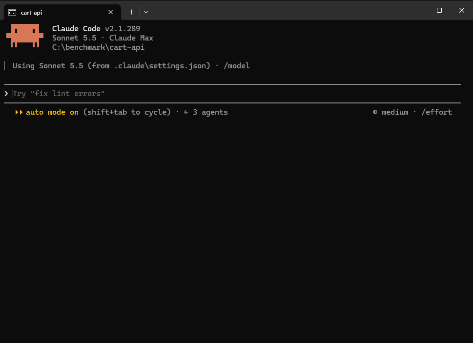

<p align="center">
  
</p>

<p align="center">
  
  
  
  <a href="https://github.com/emetgate/emetgate/actions/workflows/ci.yml"></a>
  <a href="https://github.com/emetgate/emetgate/releases/latest"></a>
</p>

<p align="center"><b>English</b> · <a href="translations/README.tr.md">Türkçe</a> · <a href="translations/README.ko.md">한국어</a> · <a href="translations/README.zh-CN.md">简体中文</a> · <a href="translations/README.es.md">Español</a></p>

# Emetgate

You write "no comments" and "no Co-Authored-By" in your `CLAUDE.md`. The model follows them for a while, then it stops. A longer file only asks again.

Emetgate sits between Claude Code and your source tree. The model proposes a change, your rules and your tests judge it on a copy of the repository, and the file changes only if it passes. A rule you set is checked on every write tool call and every `emetgate_commit`, however long the session runs and even when you ask the model to break it. Every passing change leaves a receipt you can check later.

```
"status":"rejected","reason":"rule_violation"
"rule_text":"no new comments","file":"src\\cart.js","line":18
"text":"// apply the coupon before tax"
emetgate ✗ rejected · rule_violation · disk untouched · session 0 edits
```

Emetgate is a witness, not a guarantee. It reports what ran and what happened; it cannot tell you the code is correct or safe. See [Limits](#limits).

Windows only. Needs [Claude Code](https://claude.ai/code) and Git.

<p align="center"></p>

## Start

Download the binary and put it on your `PATH` (PowerShell):

```
New-Item -ItemType Directory -Force "$env:USERPROFILE\emetgate" | Out-Null
Invoke-WebRequest "https://github.com/emetgate/emetgate/releases/latest/download/emetgate.exe" -OutFile "$env:USERPROFILE\emetgate\emetgate.exe"
[Environment]::SetEnvironmentVariable("Path", [Environment]::GetEnvironmentVariable("Path", "User") + ";$env:USERPROFILE\emetgate", "User")
```

Then open a new terminal, go to your project folder and run:

```
emetgate lockdown
```

That is the whole setup. To enforce your own rules, type this in the session. Here 19 is no new comments and 26 is no Co-authored-by, and `/rule pick` lists all 30:

```
/rule pick 19 26
```

The other rows here are optional:

| to | run | what it does |
| --- | --- | --- |
| start a session | `emetgate lockdown` | opens Claude Code with the emetgate tools instead of its built-in ones; the test command is detected on every write |
| check the setup | `emetgate doctor` | one line per check; every `FAIL` ends with the command that fixes it |
| name the test command | `claude mcp add --scope project emetgate -- emetgate mcp --test "npm test"` | for when detection finds nothing, or finds the wrong command; writes `.mcp.json` |
| add a typecheck | the same line with `--typecheck "npx tsc --noEmit"` | `tsc` is not detected, so it has to be named |
| check the download | `Get-FileHash "$env:USERPROFILE\emetgate\emetgate.exe" -Algorithm SHA256` | compare with `emetgate.exe.sha256` on the release page |
| build from source | `zig build -Doptimize=ReleaseSafe` | needs Zig 0.16.0 |

Each release ships a SHA-256 file and a build provenance attestation. The binary is not code-signed yet. Step by step: [docs/QUICKSTART.md](docs/QUICKSTART.md).

## What changes in a session

| the model wants to | what happens |
| --- | --- |
| read or search | runs without a prompt, through tools that send less text than whole files |
| run a command | any command runs, and long output comes back trimmed |
| run a destructive command | you are asked first: `rm -rf`, `git reset --hard`, `git push --force`, `DROP TABLE`, a disk format, a downloaded script piped to a shell, and similar |
| change a file | you are asked as usual, then the change goes through the gate |

An empty folder gets `git init`. A drive root, your home folder, a system folder or a very large folder does not; lockdown refuses there. A folder that already has a repository is left as it is.

## The gate

```
proposal ─▶ reparse ─▶ rules ─▶ typecheck ─▶ tests ─▶ write + receipt  (אמת)
                  └── a step fails ─▶ nothing is written (מת)
```

A code change names a symbol and the hash of the code it was based on, so a stale edit is refused. The change is applied to a copy of the repository, and the steps run there. If a step fails, your files stay as they were and the reply carries each failing test's output, so the model can fix it without running the suite again.

What each step does and does not do:

| step | runs when | notes |
| --- | --- | --- |
| reparse | always, for languages with a parser | shows the file still parses |
| rules | when you have rules | see [Rules](#rules) |
| typecheck | when the project configures mypy or pyright, or has one `dotnet` project in its root, or with `--typecheck` | `tsc` is not detected; pass it with `--typecheck` |
| tests | when a test command is found and code changed | no test command: the write lands marked `unverified_no_tests`; only non-code files changed: no test runs |
| receipt | on every write that passes | see [Receipts](#receipts) |

The gate's test rule is: **no test may fail that did not fail before.** A test that was already failing does not block a write, and the reply names it (`baseline_failing`, `failing_tests`). pytest and `dotnet test` also let a new failing test stay until `emetgate_commit`, with the debt kept in `tests/debt.json`, so you can write a test first and make it pass next. A change the analysis proves cannot reach beyond its own symbol runs a scoped test command, if one is configured, instead of the full suite.

## Languages

| | read, try, scan, rules | rename | move, move_file | call graph (`facts`) | `explore`, `map` |
| --- | :-: | :-: | :-: | :-: | :-: |
| TypeScript, TSX, JavaScript | yes | yes | yes | yes | yes |
| Python | yes | yes | yes | yes | `map` yes, `explore` partial |
| C# | yes | yes | types and static members | partial | `map` yes, `explore` partial |
| Zig | yes (top-level functions) | no | no | no | no |
| JSON, Markdown | section reads and writes | - | - | - | - |

`map` recognises Python and C# tests, routes and commands. `explore` still reads some names as tests that are not, such as `latest_news.py`. Rename cannot follow a method called through an untyped local. An instance C# member does not move, because it depends on its object. Moving a Python symbol out of a file with decorators or top-level statements needs `order_change:true`. There is no language service for Python or C#. Parity for both is in progress.

Test commands are detected from `package.json`, `build.zig`, `Cargo.toml`, `go.mod`, Python project markers, `.sln`, `.slnx`, `.csproj`, `.fsproj`, `.vbproj` and nested test projects.

## Tools

The model gets 23 tools. Full parameters: [REFERENCE.md](REFERENCE.md).

| | tools |
| --- | --- |
| understand | `explore` (a question to definition, callers and impact), `evidence`, `symbols`, `skeleton` |
| read | `read_symbol`, `read_file` (up to 32 files in one call, JSON pointer, Markdown heading, line range), `list` |
| search | `search` (literal or regex, by tracked file), `find` (case-folded literal in any file) |
| change code | `try`, `try_batch` (many files, all or none), `edit`, `write`, `rename`, `move`, `move_file` |
| change documents | `write_doc` (JSON, Markdown, ranges) |
| check | `scan` (one check over the repository), `mutate` (preview) |
| git and shell | `git` (read-only), `git_write` (flag allowlist; loss needs `force: true`), `commit` (with receipt), `run` |

Command-line tools, for you: `doctor`, `verify`, `rule`, `rules` (terminal UI), `recover`, `commit`, `receipts attach`, `facts`, `map`, `find`, `scan`, `stats`.

## Rules

A rule you set with `--enforce` is held on every write; without it, the rule is only recorded and shown. The model can read rules and cannot change them, and a command that would change them asks you first. Rules live in `.emetgate/ledger.ndjson`, append only.

**Setting a rule.** `/rule` lines are handled before the prompt is sent, so they never reach the model.

| where | command | what it does |
| --- | --- | --- |
| in a session | `/rule pick` | shows the 30 ready rules below |
| in a session | `/rule pick 1 19 26 in src/` | adopts those rules, here only under `src/` |
| in a session | `/rule add "ban lodash" --check forbid_import:lodash --enforce` | adds your own rule |
| in a session | `/rule list`, `/rule supersede <id> "new text"`, `/rule forget <id>` | shows or replaces a rule, or stops using it |
| in a terminal | `emetgate rule add ...` | the same commands, without the slash |
| in a terminal | `emetgate rules` | terminal UI for the same rules |

`--in` limits a rule to a file, a folder ending in `/`, or `file#symbol`.

**What a rule can check.**

| check | a write is refused when |
| --- | --- |
| `no_comment` | it has a comment |
| `require_comment` | a function, method or class has no comment before it |
| `no_todo` | it has `TODO`, `FIXME` or `XXX` |
| `forbid:<text>` | it has this text |
| `require:<text>` | it does not have this text |
| `forbid_regex:<pattern>` | it matches this regex |
| `no_literal:<option>` | it hard-codes this option, e.g. `no_literal:timeout` on `timeout: 30000` |
| `forbid_import:<module>` | it imports this module |
| `max_function_lines:<n>` | a function is longer than n lines |
| `q:<query>` | this tree-sitter query matches |
| `added:<check>` | the check fails only on what the change adds, so old code does not block a write |
| `cmd:<command>` | your own command, run on the copy in the sandbox, reports a violation |
| `frozen` | it changes a path in the rule's `--in` scope |
| `message:<check>` | the commit message breaks it: `forbid`, `require`, `max_lines`, `max_subject`, `max_line`, `conventional` |

**The ready rules in `/rule pick`.**

| group | rules |
| --- | --- |
| code style, JS and TS | no `console.log`, `debugger`, `alert`, `var`, `any`, `document.write`, `innerHTML`, `dangerouslySetInnerHTML`, focused tests (`.only`), `@ts-ignore` |
| code style, Python | no `print`, `exec`, `assert`, bare `except`, `pickle` |
| code style, C# | no `Console.WriteLine`, `Debug.WriteLine`, `Thread.Sleep` |
| code style, any language | no new comments, doc comment on definitions, functions at most 50 lines, no `TODO`/`FIXME`/`XXX` |
| security | no `eval`, hardcoded secrets (by regex), `http://` URLs |
| git hygiene | no `Co-authored-by`, no "Generated with Claude", no `WIP`, conventional commit subject |
| architecture | freeze a path |

A `frozen` path cannot change through a write tool, and `emetgate_run` puts it back after every command. A `git commit` through `emetgate_run` asks you first.

## Receipts

A passing write is bound to an [in-toto](https://in-toto.io) record of what was built from what, with which tests. `emetgate_commit` stores it as a git note under `refs/notes/emetgate`.

```
$ emetgate verify --branch main..HEAD
branch partial: 48 commit(s)          # no receipt: not called verified
  a179a7f unverified (no receipt)  cert 84c2…

# after tampering with one receipt:
branch broken: 1 commit(s)
  3ff23a0 MISMATCH  cert ec79…
```

A commit is `verified`, `merged`, `unverified` or `mismatch`; a range is `verified`, `partial`, `broken` or `empty`, and an empty range fails. `tools/verify_py/emetgate_verify.py` checks receipts independently, in Python.

Receipts are not signed and the chain tip is not published. This catches a receipt edited inconsistently with its commit. It does not catch a commit rewritten together with a freshly made, consistent receipt.

## Search

There are two search tools, and neither sends whole files back.

| | `search` | `find` |
| --- | --- | --- |
| looks in | git-tracked text files under `dir` | every file git lists, tracked or untracked, not ignored |
| matches | case-sensitive literal, or a regex with `regex:true` | literal in any letter case, any bytes, any language |
| index | trigrams | suffix array and wavelet matrix, in one memory-mapped file |
| reply | each file once, then `line:text` per hit, `*` on a definition | hit and file counts, the 20 files with the most hits, the first 40 hits |
| when there are many hits | `partial`, with the next offset to continue from | the reply stays the same size |
| narrowing | `kinds:["code"]` skips comments and strings | - |
| use it for | code | logs, config, generated and untracked files |

`search` also answers with a Merkle root (RFC 9162) over the files it read, so a complete answer and a partial one are told apart in the reply. A regex the index cannot serve goes to ripgrep, and the reply says `delegated: rg`. If the certificate's numbers do not add up, the reply is refused as `InconsistentCertificate`.

```
$ search "InconsistentCertificate"
✓ 6 matches in 429 files
$ search "Allocator"
partial: matches 1-46 of 1617; next offset:46
$ search "zzzNeverOccurs"
✓ no match in 569 files
```

On n8n: <!-- generated:search-summary -->a new session's first search 5.5 to 22.7 ms and later searches 1.9 to 10.1 ms, against rg 27.2 to 80.9 ms and git grep 29.1 to 65.7 ms; building the index the first time, once per repository, took 91 to 1,335 ms (2026-09-27, scan bandwidth 3.13 GB/s)<!-- /generated -->.

## How it's tested

Mutation testing breaks the code on purpose and checks that the suite notices. Fuzz and red-team corpora feed it unexpected and hostile input. CI runs the full suite in Debug and ReleaseSafe on every pull request, and a nightly run covers the whole mutation corpus.

For the engine: <!-- generated:engine-mutant-summary -->69 mutants today: 58 killed, 6 proven equivalent, 4 redundant guards kept as defense in depth, 1 open<!-- /generated -->. The list is in [VERIFICATION.md](VERIFICATION.md).

## Limits

- Windows only.
- **Passing the gate proves a change parses and passes your tests.** It is only as strong as those tests, and with no tests it proves little (`unverified_no_tests`).
- **Rules hold only after you set them, and they judge the write tools and `emetgate_commit`.** A command run through `emetgate_run` is not judged: a script the model runs can add a comment, and only `frozen` paths are put back. A `git commit` there asks you first, and the message rules do not read it.
- **Nothing checks whether a test got weaker.** Without a `frozen` rule on the test folder, an edit that changes a test and passes is written.
- **`emetgate_run` in lockdown is not sandboxed.** A command runs with your permissions.
- **The destructive-command prompt reads the command's words.** It does not see inside a script the model wrote and then runs, so it is a speed bump, not a wall. Read what you approve.
- **`frozen` has holes.** A commit made by a script the model runs gets no prompt; it is reported in `frozen_committed` and `emetgate verify` will not call it verified. Ignored files, untracked build and cache folders, symbolic links, submodule folders and processes that outlive the command are not held. `emetgate_git_write` commands other than `commit`, such as `reset`, `restore` or `stash`, can still move a frozen path.
- The sandbox around the gate's own test runs blocks writes, not reads or the network.
- Python and C# have the gaps listed under [Languages](#languages).
- The benchmarks are our own, from one machine, and reproducible from [tests/bench](tests/bench).

## Going further

- [docs/QUICKSTART.md](docs/QUICKSTART.md): install step by step
- [REFERENCE.md](REFERENCE.md): every tool and flag, including `.mcp.json` setup, `--commit`, `--typecheck`, `--allow-run` and `.emetgaterc.json`
- [VERIFICATION.md](VERIFICATION.md): receipts and proof

## Where the name comes from

<picture>
  <source media="(prefers-color-scheme: dark)" srcset="assets/golem-ales-dark.jpg">
  
</picture>

In the Prague legend, the golem is brought to life by the word **אמת** (*emet*, "truth") on its forehead. Erase the first letter and **אמת** becomes **מת** (*met*, "dead"), and the golem falls still. The gate writes the first letter when a change holds; a failing test erases it.

<br clear="left">

## License

MIT. See [LICENSE](LICENSE).
