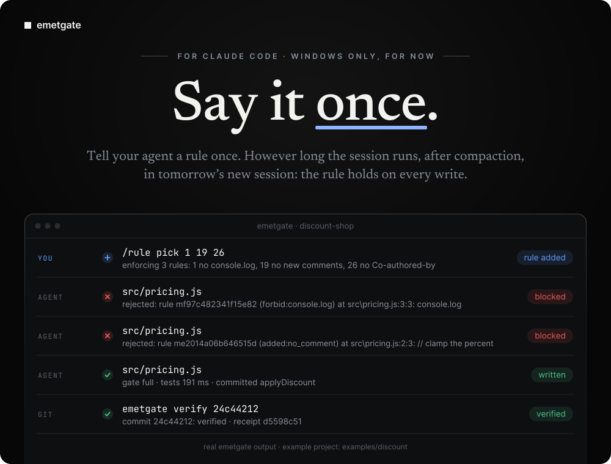
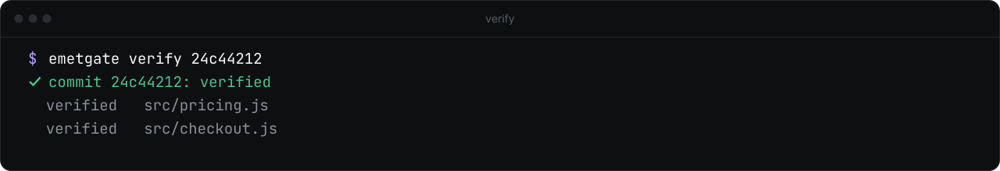

<p align="center">
  
</p>

<p align="center"><a href="docs/QUICKSTART.md"><b>Quickstart</b></a> · <a href="REFERENCE.md"><b>Reference</b></a> · <a href="VERIFICATION.md"><b>Verification</b></a> · <a href="examples/discount"><b>A real session</b></a></p>

<p align="center"><sub><b>English</b> · <a href="translations/README.tr.md">Türkçe</a> · <a href="translations/README.ko.md">한국어</a> · <a href="translations/README.zh-CN.md">简体中文</a> · <a href="translations/README.es.md">Español</a></sub></p>

> [!NOTE]
> Windows only, for now. Built for Claude Code; works on TypeScript, JavaScript, Python, C# and Zig projects.

You tell your agent "no comments". It listens for a while. Then the session gets long, the context is compacted, a new session starts the next day, and the same comment comes back. You put it in CLAUDE.md; it stays a request there too.

In emetgate a rule does not live in the conversation. It lives in a separate rule book and is applied to every write the agent makes. If the agent breaks a rule, the write never reaches the disk; the agent sees why and fixes it in the same turn.

This is not a feeling. Claude Code's own documentation says the same:

> *"CLAUDE.md instructions shape Claude's behavior but are not a hard enforcement layer."* ([code.claude.com/docs/en/memory](https://code.claude.com/docs/en/memory))

<p align="center">
  <a href="assets/video/emetgate-ad-en.mp4"></a>
  <br><sub>Watch the video: we ask the agent to break the rule on purpose, and the gate still doesn't write it.</sub>
</p>

## How it works

<p align="center">
  
</p>

### Say it once

When you give a lasting instruction in chat ("from now on", "never"), emetgate asks the agent to offer the `/rule` line that turns it into a rule. You confirm it, and it becomes a rule. You can also write your own rule in one line:

```
emetgate rule add "no lint suppression" --check forbid_regex:eslint-disable --enforce
```

Or pick from the ready catalog, where the common ones live: no `console.log`, no new comments, no `Co-authored-by`:


### The session ends, the rule stays

The rule lives in a ledger under `.emetgate/`. However long the session runs, after compaction, in tomorrow's new session, the same rule applies to every write.

Under `emetgate lockdown`, Claude Code's own edit and write tools are off; the agent changes files through emetgate's tools, and every change passes the same rules. The agent has no tool to add, change or remove a rule; a command that tries to is asked about first.

Adding a rule to an old repository breaks nothing: only new violations are refused.

### Fixed before you see it

A refusal goes back to the agent with its line and column; the agent fixes it in the same turn. You see the result that follows the rule.

```
rejected: rule mf97c482341f15e82 (forbid:console.log) at src\pricing.js:3:3: console.log
rejected: rule me2014a06b646515d (added:no_comment) at src\pricing.js:2:3: // clamp the percent
```

## Why a hook or ESLint is not enough

You can build part of this yourself with Claude Code hooks and ESLint. The difference:

- **The gate is the same for every write tool.** Lockdown turns off Claude Code's own edit tools; edits, renames and moves pass the same rules. If the agent changes a file with a shell command, it is recorded, frozen paths are put back, and a change that did not pass the gate cannot be committed through emetgate.
- **The agent can switch ESLint off.** An `eslint-disable` line and `.eslintrc` live in files the agent can edit. emetgate's rules live in a ledger the agent has no tool to change; adding `eslint-disable` can itself hit a rule.
- **The change is checked as a whole.** A change that touches several files is checked together on a copy of the repository; if it passes all of it is written, if not none of it is.
- **From chat to rule.** A lasting instruction you give is offered as a rule; you do not write a script per rule.

## Also

**Search says what it read.** When the agent says "I found every use", the answer shows how many files it scanned and whether it read them all. If the numbers do not add up, no result is shown.


**Commits carry a record.** Every commit made through the gate carries, in `refs/notes/emetgate`, which files were written and which checks ran. It is a record, not a signature: it shows later how something was written.



## Start in 2 minutes

In PowerShell, then open a new terminal:

```
irm https://github.com/emetgate/emetgate/releases/latest/download/install.ps1 | iex
```

In your project folder:

```
emetgate doctor
emetgate rule pick 1 19 26
emetgate lockdown
```

`emetgate lockdown` starts Claude Code with only emetgate's tools. Step by step: [docs/QUICKSTART.md](docs/QUICKSTART.md).

## Limits

- Windows only, for now.
- Rules apply to changes made through emetgate's write tools. A command the agent runs does not pass the gate: the files it changes are reported and frozen paths are put back, but the other rules do not apply to commands.
- The rule ledger is a file under `.emetgate/`. The agent has no tool to write it, but an edit made by a command is not caught by the hook that watches rule commands.
- Outside lockdown, in a session opened with the agent's own tools, there is no gate. In other agents that speak MCP, the gate works as long as the agent uses emetgate's tools.
- Every write takes about 0.2–0.4 s at the gate. We do not promise fewer tokens.
- Receipts are not signed: they catch a receipt edited out of step with its commit, not a rewritten history.
- The destructive-command check looks at words; it is not a sandbox.

## Under the hood

<details>
<summary>The gate: reparse, rules, typecheck and tests on a copy, then one write</summary>

A change names a symbol and the hash of the code it was based on. emetgate puts the new body in place, reparses the file, runs the rules, then runs the typecheck and the tests on a copy of the repository inside a low-integrity sandbox. If every step passes it is written; if one fails, nothing is written. The write goes through a journal; if it is cut off, `emetgate recover` repairs it.

</details>

<details>
<summary>Rules: syntax-tree queries, patterns, commands, frozen paths, commit messages</summary>

Rule checks are syntax-tree queries (`no_comment`, `require_comment`, `max_function_lines`, `forbid_import`), step-limited regex in the changed span (`forbid_regex`, `no_todo`), commands, frozen paths and commit-message checks (`message:conventional`, no Co-authored-by). The ledger `ledger.ndjson` is append-only; the model reads it and has no tool to write it. Lockdown's chat hook handles a `/rule` line before it reaches the model and offers to turn a lasting instruction into a rule.

</details>

<details>
<summary>Search and verification: the techniques</summary>

Search uses a suffix-array index and trigram lists; it shows whether an answer is complete or partial with an RFC 9162 Merkle root over the SHA-256 of every file read, and is compared line for line with ripgrep. Commit records are in-toto statements, and `emetgate verify --branch main..HEAD` checks a whole range; a commit without a receipt counts as `partial`. Details: [REFERENCE.md](REFERENCE.md), [VERIFICATION.md](VERIFICATION.md).

</details>

## Where the name comes from

In the Prague legend, the golem comes to life by the word **אמת** (*emet*, "truth") on its forehead; erase the first letter and it becomes **מת** (*met*, "dead"), and it stops. In emetgate, a change that breaks a rule is not written.

MIT. See [LICENSE](LICENSE).
