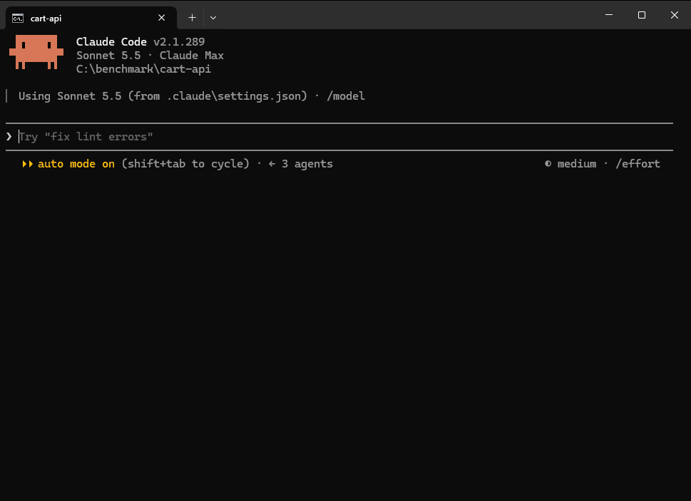

<p align="center">
  
</p>

<p align="center">
  
  
  
  <a href="https://github.com/emetgate/emetgate/actions/workflows/ci.yml"></a>
  <a href="https://github.com/emetgate/emetgate/releases/latest"></a>
</p>

<p align="center"><a href="../README.md">English</a> · <a href="README.tr.md">Türkçe</a> · <a href="README.ko.md">한국어</a> · <a href="README.zh-CN.md">简体中文</a> · <b>Español</b></p>

# Emetgate

Escribes "sin comentarios" y "sin Co-Authored-By" en tu `CLAUDE.md`. El modelo obedece un tiempo y luego deja de hacerlo. Un archivo más largo solo lo pide otra vez.

Emetgate se sitúa entre Claude Code y tu código fuente. El modelo propone un cambio, tus reglas y tus tests lo juzgan en una copia del repositorio, y el archivo cambia solo si pasa. Una regla que fijas se comprueba en cada llamada a una herramienta de escritura y en cada `emetgate_commit`, por larga que sea la sesión e incluso si tú mismo le pides al modelo que la rompa. Cada cambio que pasa deja un recibo que puedes comprobar después.

```
"status":"rejected","reason":"rule_violation"
"rule_text":"no new comments","file":"src\\cart.js","line":18
"text":"// apply the coupon before tax"
emetgate ✗ rejected · rule_violation · disk untouched · session 0 edits
```

Emetgate es un testigo, no una garantía. Informa de qué se ejecutó y qué ocurrió; no puede decirte que el código sea correcto o seguro. Consulta [Límites](#límites).

Solo Windows. Necesita [Claude Code](https://claude.ai/code) y Git.

<p align="center"></p>

## Inicio

Descarga el binario y añádelo a tu `PATH` (PowerShell):

```
New-Item -ItemType Directory -Force "$env:USERPROFILE\emetgate" | Out-Null
Invoke-WebRequest "https://github.com/emetgate/emetgate/releases/latest/download/emetgate.exe" -OutFile "$env:USERPROFILE\emetgate\emetgate.exe"
[Environment]::SetEnvironmentVariable("Path", [Environment]::GetEnvironmentVariable("Path", "User") + ";$env:USERPROFILE\emetgate", "User")
```

Luego abre una terminal nueva, ve a la carpeta de tu proyecto y ejecuta:

```
emetgate lockdown
```

Esa es toda la instalación. Para hacer cumplir tus reglas, escribe esto en la sesión. Aquí 19 es sin comentarios nuevos y 26 es sin Co-authored-by, y `/rule pick` lista las 30:

```
/rule pick 19 26
```

Las demás filas son opcionales:

| para | ejecuta | qué hace |
| --- | --- | --- |
| iniciar una sesión | `emetgate lockdown` | abre Claude Code con las herramientas de emetgate en lugar de las integradas; el comando de test se detecta en cada escritura |
| comprobar la instalación | `emetgate doctor` | una línea por comprobación; cada `FAIL` termina con el comando que lo arregla |
| indicar el comando de test | `claude mcp add --scope project emetgate -- emetgate mcp --test "npm test"` | para cuando la detección no encuentra nada o encuentra el comando equivocado; escribe `.mcp.json` |
| añadir un typecheck | la misma línea con `--typecheck "npx tsc --noEmit"` | `tsc` no se detecta, así que hay que indicarlo |
| comprobar la descarga | `Get-FileHash "$env:USERPROFILE\emetgate\emetgate.exe" -Algorithm SHA256` | compáralo con `emetgate.exe.sha256` en la página de la versión |
| compilar desde el código | `zig build -Doptimize=ReleaseSafe` | necesita Zig 0.16.0 |

Cada versión incluye un archivo SHA-256 y una attestation de procedencia de la compilación. El binario aún no está firmado. Paso a paso: [docs/QUICKSTART.md](../docs/QUICKSTART.md).

## Qué cambia en una sesión

| el modelo quiere | qué ocurre |
| --- | --- |
| leer o buscar | se ejecuta sin preguntar, con herramientas que envían menos texto que los archivos completos |
| ejecutar un comando | se ejecuta cualquier comando, y la salida larga vuelve recortada |
| ejecutar un comando destructivo | primero se te pregunta: `rm -rf`, `git reset --hard`, `git push --force`, `DROP TABLE`, formatear un disco, pasar un script descargado a un shell, y similares |
| cambiar un archivo | se te pregunta como siempre, y luego el cambio pasa por la puerta |

Una carpeta vacía recibe `git init`. La raíz de una unidad, tu carpeta personal, una carpeta del sistema o una carpeta muy grande no; lockdown se niega ahí. Una carpeta que ya tiene repositorio se deja como está.

## La puerta

```
proposal ─▶ reparse ─▶ rules ─▶ typecheck ─▶ tests ─▶ write + receipt  (אמת)
                  └── a step fails ─▶ nothing is written (מת)
```

Un cambio de código nombra un símbolo y el hash del código en el que se basó, así que una edición obsoleta se rechaza. El cambio se aplica a una copia del repositorio y los pasos se ejecutan allí. Si un paso falla, tus archivos quedan como estaban y la respuesta incluye la salida de cada test fallido, para que el modelo pueda arreglarlo sin volver a ejecutar la suite.

Qué hace y qué no hace cada paso:

| paso | se ejecuta cuando | notas |
| --- | --- | --- |
| reparse | siempre, en lenguajes con parser | muestra que el archivo sigue siendo analizable |
| reglas | cuando tienes reglas | consulta [Reglas](#reglas) |
| typecheck | cuando el proyecto configura mypy o pyright, tiene un solo proyecto `dotnet` en la raíz, o con `--typecheck` | `tsc` no se detecta; pásalo con `--typecheck` |
| tests | cuando se encuentra un comando de test y cambió código | sin comando de test: la escritura se hace marcada `unverified_no_tests`; si solo cambiaron archivos que no son código: no se ejecuta ningún test |
| recibo | en cada escritura que pasa | consulta [Recibos](#recibos) |

La regla de tests de la puerta es: **no puede fallar ningún test que no fallara antes.** Un test que ya fallaba no bloquea una escritura, y la respuesta lo nombra (`baseline_failing`, `failing_tests`). pytest y `dotnet test` también permiten que un test nuevo que falla se quede hasta `emetgate_commit`, con la deuda guardada en `tests/debt.json`, para que puedas escribir primero el test y hacerlo pasar después. Un cambio que el análisis demuestra que no puede ir más allá de su propio símbolo ejecuta un comando de test acotado, si está configurado, en lugar de la suite completa.

## Lenguajes

| | read, try, scan, reglas | rename | move, move_file | grafo de llamadas (`facts`) | `explore`, `map` |
| --- | :-: | :-: | :-: | :-: | :-: |
| TypeScript, TSX, JavaScript | sí | sí | sí | sí | sí |
| Python | sí | sí | sí | sí | `map` sí, `explore` parcial |
| C# | sí | sí | tipos y miembros estáticos | parcial | `map` sí, `explore` parcial |
| Zig | sí (funciones de nivel superior) | no | no | no | no |
| JSON, Markdown | lectura y escritura de secciones | - | - | - | - |

`map` reconoce tests, rutas y comandos de Python y C#. `explore` aún toma por tests algunos nombres que no lo son, como `latest_news.py`. Rename no puede seguir un método llamado a través de una variable local sin tipo. Un miembro de instancia de C# no se mueve, porque depende de su objeto. Mover un símbolo de Python fuera de un archivo con decoradores o sentencias de nivel superior necesita `order_change:true`. No hay servicio de lenguaje para Python ni C#. La paridad de ambos está en curso.

Los comandos de test se detectan desde `package.json`, `build.zig`, `Cargo.toml`, `go.mod`, marcadores de proyecto Python, `.sln`, `.slnx`, `.csproj`, `.fsproj`, `.vbproj` y proyectos de test anidados.

## Herramientas

El modelo recibe 23 herramientas. Parámetros completos: [REFERENCE.md](../REFERENCE.md).

| | herramientas |
| --- | --- |
| entender | `explore` (de una pregunta a definición, llamadores e impacto), `evidence`, `symbols`, `skeleton` |
| leer | `read_symbol`, `read_file` (hasta 32 archivos en una llamada, JSON pointer, encabezado Markdown, rango de líneas), `list` |
| buscar | `search` (literal o regex, por archivo rastreado), `find` (literal sin distinción de mayúsculas en cualquier archivo) |
| cambiar código | `try`, `try_batch` (muchos archivos, todo o nada), `edit`, `write`, `rename`, `move`, `move_file` |
| cambiar documentos | `write_doc` (JSON, Markdown, rangos) |
| comprobar | `scan` (una comprobación sobre el repositorio), `mutate` (vista previa) |
| git y shell | `git` (solo lectura), `git_write` (lista de flags permitidos; una pérdida necesita `force: true`), `commit` (con recibo), `run` |

Herramientas de línea de comandos, para ti: `doctor`, `verify`, `rule`, `rules` (interfaz de terminal), `recover`, `commit`, `receipts attach`, `facts`, `map`, `find`, `scan`, `stats`.

## Reglas

Una regla fijada con `--enforce` se hace cumplir en cada escritura; sin ello, la regla solo se registra y se muestra. El modelo puede leer las reglas y no puede cambiarlas, y un comando que las cambiaría te pregunta primero. Las reglas viven en `.emetgate/ledger.ndjson`, de solo añadir.

**Fijar una regla.** Las líneas `/rule` se procesan antes de enviar el prompt, así que nunca llegan al modelo.

| dónde | comando | qué hace |
| --- | --- | --- |
| en una sesión | `/rule pick` | muestra las 30 reglas listas de abajo |
| en una sesión | `/rule pick 1 19 26 in src/` | adopta esas reglas, aquí solo bajo `src/` |
| en una sesión | `/rule add "ban lodash" --check forbid_import:lodash --enforce` | añade tu propia regla |
| en una sesión | `/rule list`, `/rule supersede <id> "new text"`, `/rule forget <id>` | muestra o sustituye una regla, o deja de usarla |
| en una terminal | `emetgate rule add ...` | los mismos comandos, sin la barra |
| en una terminal | `emetgate rules` | interfaz de terminal para las mismas reglas |

`--in` limita una regla a un archivo, una carpeta terminada en `/`, o `file#symbol`.

**Qué puede comprobar una regla.**

| comprobación | una escritura se rechaza cuando |
| --- | --- |
| `no_comment` | tiene un comentario |
| `require_comment` | una función, método o clase no tiene comentario delante |
| `no_todo` | tiene `TODO`, `FIXME` o `XXX` |
| `forbid:<text>` | tiene este texto |
| `require:<text>` | no tiene este texto |
| `forbid_regex:<pattern>` | coincide con esta regex |
| `no_literal:<option>` | escribe esta opción a mano, p. ej. `no_literal:timeout` en `timeout: 30000` |
| `forbid_import:<module>` | importa este módulo |
| `max_function_lines:<n>` | una función tiene más de n líneas |
| `q:<query>` | coincide esta consulta tree-sitter |
| `added:<check>` | la comprobación falla solo en lo que añade el cambio, así que el código antiguo no bloquea una escritura |
| `cmd:<command>` | tu propio comando, ejecutado en la copia dentro del sandbox, informa de una infracción |
| `frozen` | cambia una ruta dentro del ámbito `--in` de la regla |
| `message:<check>` | el mensaje de commit la incumple: `forbid`, `require`, `max_lines`, `max_subject`, `max_line`, `conventional` |

**Las reglas listas de `/rule pick`.**

| grupo | reglas |
| --- | --- |
| estilo de código, JS y TS | sin `console.log`, `debugger`, `alert`, `var`, `any`, `document.write`, `innerHTML`, `dangerouslySetInnerHTML`, tests enfocados (`.only`), `@ts-ignore` |
| estilo de código, Python | sin `print`, `exec`, `assert`, `except` desnudo, `pickle` |
| estilo de código, C# | sin `Console.WriteLine`, `Debug.WriteLine`, `Thread.Sleep` |
| estilo de código, cualquier lenguaje | sin comentarios nuevos, doc comment en definiciones, funciones de 50 líneas como máximo, sin `TODO`/`FIXME`/`XXX` |
| seguridad | sin `eval`, secretos escritos a mano (por regex), URLs `http://` |
| higiene de git | sin `Co-authored-by`, sin "Generated with Claude", sin `WIP`, asunto conventional commit |
| arquitectura | congelar una ruta |

Una ruta `frozen` no puede cambiar mediante una herramienta de escritura, y `emetgate_run` la restaura tras cada comando. Un `git commit` a través de `emetgate_run` te pregunta primero.

## Recibos

Una escritura que pasa queda ligada a un registro [in-toto](https://in-toto.io) de qué se construyó a partir de qué, con qué tests. `emetgate_commit` lo guarda como nota de git bajo `refs/notes/emetgate`.

```
$ emetgate verify --branch main..HEAD
branch partial: 48 commit(s)          # no receipt: not called verified
  a179a7f unverified (no receipt)  cert 84c2…

# after tampering with one receipt:
branch broken: 1 commit(s)
  3ff23a0 MISMATCH  cert ec79…
```

Un commit es `verified`, `merged`, `unverified` o `mismatch`; un rango es `verified`, `partial`, `broken` o `empty`, y un rango vacío falla. `tools/verify_py/emetgate_verify.py` comprueba los recibos de forma independiente, en Python.

Los recibos no están firmados y la punta de la cadena no se publica. Esto detecta un recibo editado de forma incoherente con su commit. No detecta un commit reescrito junto con un recibo nuevo y coherente.

## Búsqueda

Hay dos herramientas de búsqueda, y ninguna devuelve archivos completos.

| | `search` | `find` |
| --- | --- | --- |
| busca en | archivos de texto rastreados por git bajo `dir` | todo archivo que git lista, rastreado o no, no ignorado |
| coincide con | literal sensible a mayúsculas, o una regex con `regex:true` | literal con cualquier capitalización, cualquier byte, cualquier lenguaje |
| índice | trigramas | suffix array y wavelet matrix, en un único archivo mapeado en memoria |
| respuesta | cada archivo una vez, luego `line:text` por coincidencia, `*` en una definición | conteos de coincidencias y archivos, los 20 archivos con más coincidencias, las primeras 40 coincidencias |
| con muchas coincidencias | `partial`, con el siguiente offset para continuar | la respuesta mantiene el mismo tamaño |
| acotar | `kinds:["code"]` omite comentarios y cadenas | - |
| úsala para | código | logs, configuración, archivos generados y no rastreados |

`search` también responde con una raíz Merkle (RFC 9162) sobre los archivos que leyó, así que una respuesta completa y una parcial se distinguen en la propia respuesta. Una regex que el índice no puede servir va a ripgrep, y la respuesta dice `delegated: rg`. Si los números del certificado no cuadran, la respuesta se rechaza como `InconsistentCertificate`.

```
$ search "InconsistentCertificate"
✓ 6 matches in 429 files
$ search "Allocator"
partial: matches 1-46 of 1617; next offset:46
$ search "zzzNeverOccurs"
✓ no match in 569 files
```

En n8n: la primera búsqueda de una sesión nueva 5.5 a 22.7 ms y las siguientes 1.9 a 10.1 ms, frente a rg 27.2 a 80.9 ms y git grep 29.1 a 65.7 ms; crear el índice la primera vez, una vez por repositorio, tardó de 91 a 1,335 ms (2026-09-27, ancho de banda de escaneo 3.13 GB/s).

## Cómo se prueba

Las pruebas de mutación rompen el código a propósito y comprueban que la suite lo note. Los corpus de fuzz y red-team le dan entradas inesperadas y hostiles. CI ejecuta la suite completa en Debug y ReleaseSafe en cada pull request, y una ejecución nocturna cubre todo el corpus de mutación.

Para el motor: 69 mutantes hoy: 58 eliminados, 6 demostrados equivalentes, 4 guardas redundantes conservadas como defensa en profundidad, 1 abierto. La lista está en [VERIFICATION.md](../VERIFICATION.md).

## Límites

- Solo Windows.
- **Pasar la puerta demuestra que un cambio se analiza y pasa tus tests.** Es tan fuerte como esos tests, y sin tests demuestra poco (`unverified_no_tests`).
- **Las reglas solo se cumplen después de fijarlas, y juzgan las herramientas de escritura y `emetgate_commit`.** Un comando ejecutado con `emetgate_run` no se juzga: un script que ejecuta el modelo puede añadir un comentario, y solo se restauran las rutas `frozen`. Un `git commit` ahí te pregunta primero, y las reglas de mensaje no lo leen.
- **Nada comprueba que un test se haya debilitado.** Sin una regla `frozen` en la carpeta de tests, una edición que cambia un test y pasa se escribe.
- **`emetgate_run` en lockdown no está en sandbox.** Un comando se ejecuta con tus permisos.
- **La pregunta de comando destructivo lee las palabras del comando.** No ve dentro de un script que el modelo escribió y luego ejecuta, así que es un badén, no un muro. Lee lo que apruebas.
- **`frozen` tiene agujeros.** Un commit hecho por un script que ejecuta el modelo no pregunta; se informa en `frozen_committed` y `emetgate verify` no lo llamará verified. Los archivos ignorados, las carpetas de build y caché no rastreadas, los enlaces simbólicos, las carpetas de submódulos y los procesos que sobreviven al comando no se protegen. Los comandos de `emetgate_git_write` distintos de `commit`, como `reset`, `restore` o `stash`, aún pueden mover una ruta congelada.
- El sandbox alrededor de las ejecuciones de test de la puerta bloquea escrituras, no lecturas ni la red.
- Python y C# tienen las carencias listadas en [Lenguajes](#lenguajes).
- Las mediciones son nuestras, de una sola máquina, y reproducibles desde [tests/bench](../tests/bench).

## Para ir más lejos

- [docs/QUICKSTART.md](../docs/QUICKSTART.md): instalación paso a paso
- [REFERENCE.md](../REFERENCE.md): cada herramienta y flag, incluida la configuración de `.mcp.json`, `--commit`, `--typecheck`, `--allow-run` y `.emetgaterc.json`
- [VERIFICATION.md](../VERIFICATION.md): recibos y pruebas

## De dónde viene el nombre

<picture>
  <source media="(prefers-color-scheme: dark)" srcset="../assets/golem-ales-dark.jpg">
  
</picture>

En la leyenda de Praga, el gólem cobra vida por la palabra **אמת** (*emet*, "verdad") en su frente. Borra la primera letra y **אמת** se convierte en **מת** (*met*, "muerto"), y el gólem se detiene. La puerta escribe la primera letra cuando un cambio se sostiene; un test que falla la borra.

<br clear="left">

## Licencia

MIT. Consulta [LICENSE](../LICENSE).
