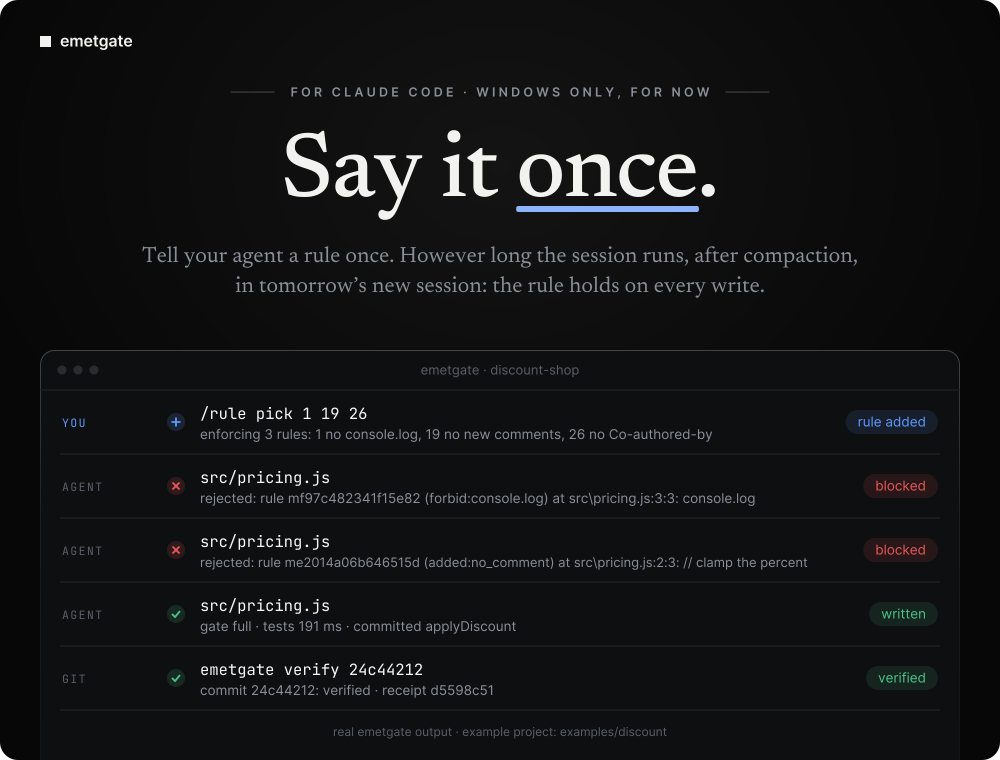
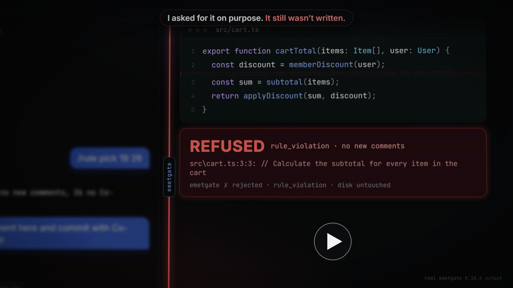
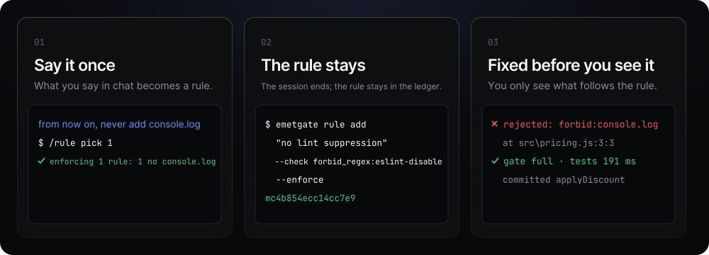
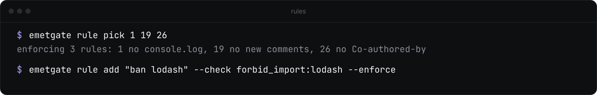
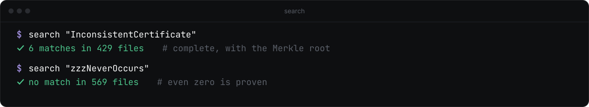
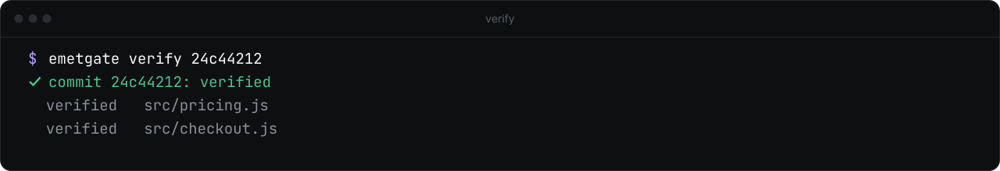

<p align="center">
  
</p>

<p align="center"><a href="../docs/QUICKSTART.md"><b>Inicio rápido</b></a> · <a href="../REFERENCE.md"><b>Referencia</b></a> · <a href="../VERIFICATION.md"><b>Verificación</b></a> · <a href="../examples/discount"><b>Una sesión real</b></a></p>

<p align="center"><sub><a href="../README.md">English</a> · <a href="README.tr.md">Türkçe</a> · <a href="README.ko.md">한국어</a> · <a href="README.zh-CN.md">简体中文</a> · <b>Español</b></sub></p>

> [!NOTE]
> Por ahora solo en Windows. Hecho para Claude Code; funciona en proyectos TypeScript, JavaScript, Python, C# y Zig.

Le dices a tu agente "sin comentarios". Te hace caso un rato. Luego la sesión se alarga, el contexto se compacta, al día siguiente empieza una sesión nueva y el mismo comentario vuelve. Lo pones en CLAUDE.md; ahí también se queda en una petición.

En emetgate una regla no vive en la conversación. Vive en un libro de reglas aparte y se aplica a cada escritura del agente. Si el agente rompe una regla, la escritura nunca llega al disco; el agente ve por qué y lo corrige en el mismo turno.

No es una impresión. La propia documentación de Claude Code dice lo mismo:

> *"CLAUDE.md instructions shape Claude's behavior but are not a hard enforcement layer."* Las instrucciones de CLAUDE.md moldean el comportamiento de Claude, pero no son una capa que las haga cumplir. ([code.claude.com/docs/en/memory](https://code.claude.com/docs/en/memory))

<p align="center">
  <a href="../assets/video/emetgate-ad-en.mp4"></a>
  <br><sub>Mira el vídeo: le pedimos al agente que rompa la regla a propósito y la puerta igual no lo escribe.</sub>
</p>

## Cómo funciona

<p align="center">
  
</p>

### Dilo una vez

Cuando das una instrucción duradera en el chat ("de ahora en adelante", "nunca"), emetgate le pide al agente que proponga la línea `/rule` que la convierte en regla. La confirmas y se convierte en regla. También puedes escribir tu propia regla en una línea:

```
emetgate rule add "no lint suppression" --check forbid_regex:eslint-disable --enforce
```

O eliges del catálogo incluido, donde están las habituales: sin `console.log`, sin comentarios nuevos, sin `Co-authored-by`:



### La sesión termina, la regla se queda

La regla vive en un registro bajo `.emetgate/`. Por larga que sea la sesión, después de compactar, en la sesión nueva de mañana, la misma regla se aplica a cada escritura.

Con `emetgate lockdown`, las herramientas propias de edición y escritura de Claude Code están apagadas; el agente cambia archivos con las herramientas de emetgate y cada cambio pasa por las mismas reglas. El agente no tiene herramienta para añadir, cambiar o borrar una regla; un comando que lo intente te pregunta primero.

Añadir una regla a un repositorio antiguo no rompe nada: solo se rechazan las infracciones nuevas.

### Corregido antes de que lo veas

El rechazo vuelve al agente con su línea y columna; el agente lo corrige en el mismo turno. Tú ves el resultado que cumple la regla.

```
rejected: rule mf97c482341f15e82 (forbid:console.log) at src\pricing.js:3:3: console.log
rejected: rule me2014a06b646515d (added:no_comment) at src\pricing.js:2:3: // clamp the percent
```

## Por qué un hook o ESLint no bastan

Con los hooks de Claude Code y ESLint puedes montar parte de esto tú mismo. La diferencia:

- **La puerta es la misma para cada herramienta de escritura.** Lockdown apaga las herramientas de edición propias de Claude Code; ediciones, renombrados y movimientos pasan por las mismas reglas. Si el agente cambia un archivo con un comando de shell, queda registrado, las rutas congeladas se restauran y un cambio que no pasó la puerta no se puede hacer commit con emetgate.
- **El agente puede apagar ESLint.** Una línea `eslint-disable` y `.eslintrc` están en archivos que el agente puede editar. Las reglas de emetgate están en un registro que el agente no tiene herramienta para cambiar; añadir `eslint-disable` puede chocar con una regla.
- **El cambio se revisa entero.** Un cambio que toca varios archivos se revisa junto sobre una copia del repositorio; si pasa se escribe todo, si no, nada.
- **Del chat a la regla.** Una instrucción duradera que das se propone como regla; no escribes un script por regla.

## Además

**La búsqueda dice qué leyó.** Cuando el agente dice "encontré todos los usos", la respuesta muestra cuántos archivos revisó y si los leyó todos. Si los números no cuadran, no se muestra resultado.



**Los commits llevan un registro.** Cada commit hecho a través de la puerta guarda en `refs/notes/emetgate` qué archivos se escribieron y qué comprobaciones corrieron. Es un registro, no una firma: muestra después cómo se escribió algo.



## Empieza en 2 minutos

En PowerShell, y luego abre una terminal nueva:

```
irm https://github.com/emetgate/emetgate/releases/latest/download/install.ps1 | iex
```

En la carpeta de tu proyecto:

```
emetgate doctor
emetgate rule pick 1 19 26
emetgate lockdown
```

`emetgate lockdown` inicia Claude Code solo con las herramientas de emetgate. Paso a paso: [docs/QUICKSTART.md](../docs/QUICKSTART.md).

## Límites

- Por ahora solo en Windows.
- Las reglas se aplican a los cambios hechos con las herramientas de escritura de emetgate. Un comando que ejecuta el agente no pasa por la puerta: los archivos que cambia se informan y las rutas congeladas se restauran, pero las demás reglas no se aplican a comandos.
- El registro de reglas es un archivo bajo `.emetgate/`. El agente no tiene herramienta para escribirlo, pero una edición hecha con un comando no la detecta el hook que vigila los comandos de reglas.
- Fuera de lockdown, en una sesión abierta con las herramientas propias del agente, no hay puerta. En otros agentes que hablan MCP, la puerta funciona mientras el agente use las herramientas de emetgate.
- Cada escritura tarda unos 0.2–0.4 s en la puerta. No prometemos menos tokens.
- Los recibos no están firmados: detectan un recibo editado fuera de sincronía con su commit, no un historial reescrito.
- La comprobación de comandos destructivos mira palabras; no es un sandbox.

## Por dentro

<details>
<summary>La puerta: reanálisis, reglas, comprobación de tipos y tests sobre una copia, y luego una sola escritura</summary>

Un cambio nombra un símbolo y el hash del código en el que se basó. emetgate coloca el cuerpo nuevo, vuelve a analizar el archivo, ejecuta las reglas y después la comprobación de tipos y los tests sobre una copia del repositorio dentro de un sandbox de baja integridad. Si todos los pasos pasan, se escribe; si uno falla, no se escribe nada. La escritura pasa por un journal; si se corta, `emetgate recover` la repara.

</details>

<details>
<summary>Reglas: consultas sobre el árbol sintáctico, patrones, comandos, rutas congeladas, mensajes de commit</summary>

Las comprobaciones de reglas son consultas sobre el árbol sintáctico (`no_comment`, `require_comment`, `max_function_lines`, `forbid_import`), regex con límite de pasos en la zona cambiada (`forbid_regex`, `no_todo`), comandos, rutas congeladas y comprobaciones del mensaje de commit (`message:conventional`, sin Co-authored-by). El registro `ledger.ndjson` solo admite añadir; el modelo lo lee y no tiene herramienta para escribirlo. El hook de chat de lockdown procesa una línea `/rule` antes de que llegue al modelo y propone convertir una instrucción duradera en regla.

</details>

<details>
<summary>Búsqueda y verificación: las técnicas</summary>

La búsqueda usa un índice de suffix array y listas de trigramas; muestra si una respuesta es completa o parcial con una raíz Merkle RFC 9162 sobre el SHA-256 de cada archivo leído, y se compara línea por línea con ripgrep. Los registros de commit son declaraciones in-toto, y `emetgate verify --branch main..HEAD` revisa un rango entero; un commit sin recibo cuenta como `partial`. Detalles: [REFERENCE.md](../REFERENCE.md), [VERIFICATION.md](../VERIFICATION.md).

</details>

## De dónde viene el nombre

En la leyenda de Praga, el gólem cobra vida con la palabra **אמת** (*emet*, "verdad") en la frente; si se borra la primera letra queda **מת** (*met*, "muerto") y se detiene. En emetgate, un cambio que rompe una regla no se escribe.

MIT. Ver [LICENSE](../LICENSE).
