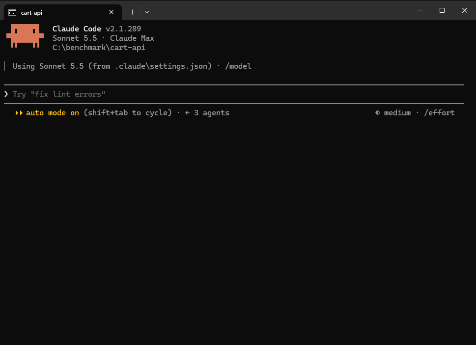

<p align="center">
  
</p>

<p align="center">
  
  
  
  <a href="https://github.com/emetgate/emetgate/actions/workflows/ci.yml"></a>
  <a href="https://github.com/emetgate/emetgate/releases/latest"></a>
</p>

<p align="center"><a href="../README.md">English</a> · <a href="README.tr.md">Türkçe</a> · <b>한국어</b> · <a href="README.zh-CN.md">简体中文</a> · <a href="README.es.md">Español</a></p>

# Emetgate

`CLAUDE.md`에 "주석 금지", "Co-Authored-By 금지"라고 적습니다. 모델은 한동안 따르다가 어느 순간 따르지 않습니다. 파일을 더 길게 써도 다시 부탁하는 것일 뿐입니다.

Emetgate는 Claude Code와 소스 트리 사이에 들어갑니다. 모델이 변경을 제안하면 저장소의 복사본에서 규칙과 테스트가 판단하고, 통과해야만 파일이 바뀝니다. 설정한 규칙은 세션이 아무리 길어져도, 모델에게 규칙을 어기라고 직접 요청해도 모든 쓰기 도구 호출과 모든 `emetgate_commit`에서 검사됩니다. 통과한 변경마다 나중에 확인할 수 있는 영수증이 남습니다.

```
"status":"rejected","reason":"rule_violation"
"rule_text":"no new comments","file":"src\\cart.js","line":18
"text":"// apply the coupon before tax"
emetgate ✗ rejected · rule_violation · disk untouched · session 0 edits
```

Emetgate는 증인이지 보증이 아닙니다. 무엇이 실행되었고 무슨 일이 있었는지 알려 줄 뿐, 코드가 올바르거나 안전하다고 말할 수는 없습니다. [한계](#한계)를 참고하세요.

Windows 전용입니다. [Claude Code](https://claude.ai/code)와 Git이 필요합니다.

<p align="center"></p>

## 시작

바이너리를 내려받아 `PATH`에 넣습니다(PowerShell):

```
New-Item -ItemType Directory -Force "$env:USERPROFILE\emetgate" | Out-Null
Invoke-WebRequest "https://github.com/emetgate/emetgate/releases/latest/download/emetgate.exe" -OutFile "$env:USERPROFILE\emetgate\emetgate.exe"
[Environment]::SetEnvironmentVariable("Path", [Environment]::GetEnvironmentVariable("Path", "User") + ";$env:USERPROFILE\emetgate", "User")
```

새 터미널을 열고 프로젝트 폴더로 이동해 실행합니다:

```
emetgate lockdown
```

설치는 이것으로 끝입니다. 자신의 규칙을 지키게 하려면 세션에서 다음을 입력합니다. 19는 새 주석 금지, 26은 Co-authored-by 금지이며, `/rule pick`은 30개 전부를 보여 줍니다:

```
/rule pick 19 26
```

나머지 행은 선택 사항입니다:

| 목적 | 실행 | 하는 일 |
| --- | --- | --- |
| 세션 시작 | `emetgate lockdown` | 내장 도구 대신 emetgate 도구로 Claude Code를 엽니다. 테스트 명령은 쓰기마다 감지됩니다 |
| 설치 확인 | `emetgate doctor` | 검사마다 한 줄. 모든 `FAIL`은 고치는 명령으로 끝납니다 |
| 테스트 명령 지정 | `claude mcp add --scope project emetgate -- emetgate mcp --test "npm test"` | 감지가 아무것도 찾지 못하거나 잘못된 명령을 찾을 때. `.mcp.json`을 씁니다 |
| 타입 검사 추가 | 같은 줄에 `--typecheck "npx tsc --noEmit"` | `tsc`는 감지되지 않으므로 지정해야 합니다 |
| 다운로드 확인 | `Get-FileHash "$env:USERPROFILE\emetgate\emetgate.exe" -Algorithm SHA256` | 릴리스 페이지의 `emetgate.exe.sha256`과 비교합니다 |
| 소스에서 빌드 | `zig build -Doptimize=ReleaseSafe` | Zig 0.16.0 필요 |

각 릴리스에는 SHA-256 파일과 빌드 출처 증명이 함께 제공됩니다. 바이너리는 아직 코드 서명되지 않았습니다. 단계별 안내: [docs/QUICKSTART.md](../docs/QUICKSTART.md).

## 세션에서 달라지는 점

| 모델이 원하는 것 | 일어나는 일 |
| --- | --- |
| 읽기 또는 검색 | 묻지 않고 실행되며, 파일 전체보다 적은 텍스트를 보내는 도구를 씁니다 |
| 명령 실행 | 어떤 명령이든 실행되고, 긴 출력은 잘려서 돌아옵니다 |
| 파괴적인 명령 실행 | 먼저 묻습니다: `rm -rf`, `git reset --hard`, `git push --force`, `DROP TABLE`, 디스크 포맷, 내려받은 스크립트를 셸로 파이프하기 등 |
| 파일 변경 | 평소처럼 묻고, 그다음 변경이 게이트를 통과합니다 |

빈 폴더에는 `git init`을 합니다. 드라이브 루트, 홈 폴더, 시스템 폴더, 아주 큰 폴더에서는 하지 않으며 lockdown이 거부합니다. 이미 저장소가 있는 폴더는 그대로 둡니다.

## 게이트

```
proposal ─▶ reparse ─▶ rules ─▶ typecheck ─▶ tests ─▶ write + receipt  (אמת)
                  └── a step fails ─▶ nothing is written (מת)
```

코드 변경은 심볼과 기반이 된 코드의 해시를 지정하므로, 오래된 편집은 거부됩니다. 변경은 저장소의 복사본에 적용되고 단계들은 거기서 실행됩니다. 단계가 실패하면 파일은 그대로이고, 응답에 실패한 각 테스트의 출력이 담겨 모델이 스위트를 다시 돌리지 않고 고칠 수 있습니다.

각 단계가 하는 일과 하지 않는 일:

| 단계 | 실행 시점 | 비고 |
| --- | --- | --- |
| reparse | 항상, 파서가 있는 언어에서 | 파일이 여전히 파싱되는지 보여 줍니다 |
| 규칙 | 규칙이 있을 때 | [규칙](#규칙) 참고 |
| 타입 검사 | 프로젝트가 mypy나 pyright를 설정했거나, 루트에 `dotnet` 프로젝트가 하나 있거나, `--typecheck`를 줬을 때 | `tsc`는 감지되지 않으니 `--typecheck`로 전달합니다 |
| 테스트 | 테스트 명령을 찾았고 코드가 바뀌었을 때 | 테스트 명령이 없으면 `unverified_no_tests` 표시로 쓰기가 이루어집니다. 코드가 아닌 파일만 바뀌면 테스트가 돌지 않습니다 |
| 영수증 | 통과한 모든 쓰기에서 | [영수증](#영수증) 참고 |

게이트의 테스트 규칙은 이렇습니다: **이전에 실패하지 않은 테스트는 실패해서는 안 됩니다.** 이미 실패하던 테스트는 쓰기를 막지 않으며, 응답이 그 테스트를 알려 줍니다(`baseline_failing`, `failing_tests`). pytest와 `dotnet test`는 새로 실패하는 테스트를 `emetgate_commit`까지 두는 것도 허용하고, 그 부채는 `tests/debt.json`에 기록되므로 테스트를 먼저 쓰고 다음에 통과시킬 수 있습니다. 분석으로 자기 심볼 밖에 영향을 줄 수 없다고 증명된 변경은, 설정되어 있으면 전체 스위트 대신 범위가 좁은 테스트 명령을 실행합니다.

## 언어

| | read, try, scan, 규칙 | rename | move, move_file | 호출 그래프(`facts`) | `explore`, `map` |
| --- | :-: | :-: | :-: | :-: | :-: |
| TypeScript, TSX, JavaScript | 예 | 예 | 예 | 예 | 예 |
| Python | 예 | 예 | 예 | 예 | `map` 예, `explore` 부분 |
| C# | 예 | 예 | 타입과 정적 멤버 | 부분 | `map` 예, `explore` 부분 |
| Zig | 예(최상위 함수) | 아니요 | 아니요 | 아니요 | 아니요 |
| JSON, Markdown | 섹션 읽기와 쓰기 | - | - | - | - |

`map`은 Python과 C#의 테스트, 라우트, 명령을 인식합니다. `explore`는 `latest_news.py`처럼 테스트가 아닌 이름을 아직 테스트로 읽기도 합니다. Rename은 타입 없는 지역 변수를 통해 호출되는 메서드를 따라가지 못합니다. C# 인스턴스 멤버는 객체에 의존하므로 이동하지 않습니다. 데코레이터나 최상위 문이 있는 파일에서 Python 심볼을 옮기려면 `order_change:true`가 필요합니다. Python과 C#용 언어 서비스는 없습니다. 두 언어의 동등 지원은 진행 중입니다.

테스트 명령은 `package.json`, `build.zig`, `Cargo.toml`, `go.mod`, Python 프로젝트 표지, `.sln`, `.slnx`, `.csproj`, `.fsproj`, `.vbproj`, 중첩된 테스트 프로젝트에서 감지합니다.

## 도구

모델은 23개 도구를 받습니다. 전체 매개변수: [REFERENCE.md](../REFERENCE.md).

| | 도구 |
| --- | --- |
| 이해 | `explore`(질문에서 정의, 호출자, 영향까지), `evidence`, `symbols`, `skeleton` |
| 읽기 | `read_symbol`, `read_file`(한 번에 최대 32개 파일, JSON pointer, Markdown 제목, 줄 범위), `list` |
| 검색 | `search`(리터럴 또는 정규식, 추적 파일 기준), `find`(모든 파일에서 대소문자 무시 리터럴) |
| 코드 변경 | `try`, `try_batch`(여러 파일, 전부 아니면 전무), `edit`, `write`, `rename`, `move`, `move_file` |
| 문서 변경 | `write_doc`(JSON, Markdown, 범위) |
| 검사 | `scan`(저장소 전체에 검사 하나), `mutate`(미리 보기) |
| git과 셸 | `git`(읽기 전용), `git_write`(플래그 허용 목록, 손실은 `force: true` 필요), `commit`(영수증 포함), `run` |

사용자용 명령줄 도구: `doctor`, `verify`, `rule`, `rules`(터미널 UI), `recover`, `commit`, `receipts attach`, `facts`, `map`, `find`, `scan`, `stats`.

## 규칙

`--enforce`로 설정한 규칙은 모든 쓰기에서 지켜지며, 없으면 기록되고 표시되기만 합니다. 모델은 규칙을 읽을 수 있지만 바꿀 수 없고, 규칙을 바꾸는 명령은 먼저 사용자에게 묻습니다. 규칙은 추가만 가능한 `.emetgate/ledger.ndjson`에 있습니다.

**규칙 설정.** `/rule` 줄은 프롬프트가 전송되기 전에 처리되므로 모델에 도달하지 않습니다.

| 위치 | 명령 | 하는 일 |
| --- | --- | --- |
| 세션에서 | `/rule pick` | 아래 30개 준비된 규칙을 보여 줍니다 |
| 세션에서 | `/rule pick 1 19 26 in src/` | 그 규칙들을 채택합니다. 여기서는 `src/` 아래만 |
| 세션에서 | `/rule add "ban lodash" --check forbid_import:lodash --enforce` | 자신의 규칙을 추가합니다 |
| 세션에서 | `/rule list`, `/rule supersede <id> "new text"`, `/rule forget <id>` | 규칙을 보여 주거나 교체하거나 사용을 중단합니다 |
| 터미널에서 | `emetgate rule add ...` | 같은 명령, 슬래시 없이 |
| 터미널에서 | `emetgate rules` | 같은 규칙을 위한 터미널 UI |

`--in`은 규칙을 파일, `/`로 끝나는 폴더, 또는 `file#symbol`로 제한합니다.

**규칙이 검사할 수 있는 것.**

| 검사 | 쓰기가 거부되는 경우 |
| --- | --- |
| `no_comment` | 주석이 있을 때 |
| `require_comment` | 함수, 메서드, 클래스 앞에 주석이 없을 때 |
| `no_todo` | `TODO`, `FIXME`, `XXX`가 있을 때 |
| `forbid:<text>` | 이 텍스트가 있을 때 |
| `require:<text>` | 이 텍스트가 없을 때 |
| `forbid_regex:<pattern>` | 이 정규식에 일치할 때 |
| `no_literal:<option>` | 이 옵션을 하드코딩할 때, 예: `timeout: 30000`에 대한 `no_literal:timeout` |
| `forbid_import:<module>` | 이 모듈을 임포트할 때 |
| `max_function_lines:<n>` | 함수가 n줄보다 길 때 |
| `q:<query>` | 이 tree-sitter 쿼리가 일치할 때 |
| `added:<check>` | 변경이 추가한 부분에서만 검사가 실패할 때. 기존 코드는 쓰기를 막지 않습니다 |
| `cmd:<command>` | 샌드박스의 복사본에서 실행한 자신의 명령이 위반을 보고할 때 |
| `frozen` | 규칙의 `--in` 범위에 있는 경로를 바꿀 때 |
| `message:<check>` | 커밋 메시지가 위반할 때: `forbid`, `require`, `max_lines`, `max_subject`, `max_line`, `conventional` |

**`/rule pick`의 준비된 규칙.**

| 그룹 | 규칙 |
| --- | --- |
| 코드 스타일, JS와 TS | `console.log`, `debugger`, `alert`, `var`, `any`, `document.write`, `innerHTML`, `dangerouslySetInnerHTML`, 집중 테스트(`.only`), `@ts-ignore` 금지 |
| 코드 스타일, Python | `print`, `exec`, `assert`, 맨 `except`, `pickle` 금지 |
| 코드 스타일, C# | `Console.WriteLine`, `Debug.WriteLine`, `Thread.Sleep` 금지 |
| 코드 스타일, 모든 언어 | 새 주석 금지, 정의에 doc comment, 함수 최대 50줄, `TODO`/`FIXME`/`XXX` 금지 |
| 보안 | `eval`, 하드코딩된 비밀(정규식으로), `http://` URL 금지 |
| git 위생 | `Co-authored-by` 금지, "Generated with Claude" 금지, `WIP` 금지, conventional commit 제목 |
| 아키텍처 | 경로 동결 |

`frozen` 경로는 쓰기 도구로 바꿀 수 없고, `emetgate_run`은 명령마다 그 경로를 되돌립니다. `emetgate_run`을 통한 `git commit`은 먼저 묻습니다.

## 영수증

통과한 쓰기는 무엇이 무엇에서 어떤 테스트로 만들어졌는지 담은 [in-toto](https://in-toto.io) 기록에 묶입니다. `emetgate_commit`은 이를 `refs/notes/emetgate` 아래 git note로 저장합니다.

```
$ emetgate verify --branch main..HEAD
branch partial: 48 commit(s)          # no receipt: not called verified
  a179a7f unverified (no receipt)  cert 84c2…

# after tampering with one receipt:
branch broken: 1 commit(s)
  3ff23a0 MISMATCH  cert ec79…
```

커밋은 `verified`, `merged`, `unverified`, `mismatch` 중 하나이고, 범위는 `verified`, `partial`, `broken`, `empty` 중 하나이며 빈 범위는 실패합니다. `tools/verify_py/emetgate_verify.py`는 영수증을 Python으로 독립적으로 검사합니다.

영수증은 서명되지 않으며 체인 끝은 공개되지 않습니다. 커밋과 맞지 않게 편집된 영수증은 잡아냅니다. 새로 만든 일관된 영수증과 함께 다시 쓴 커밋은 잡아내지 못합니다.

## 검색

검색 도구는 둘이며, 어느 쪽도 파일 전체를 돌려보내지 않습니다.

| | `search` | `find` |
| --- | --- | --- |
| 찾는 곳 | `dir` 아래 git이 추적하는 텍스트 파일 | git이 나열하는 모든 파일, 추적 여부 무관, 무시되지 않은 것 |
| 일치 | 대소문자 구분 리터럴, 또는 `regex:true`인 정규식 | 대소문자 무관 리터럴, 모든 바이트, 모든 언어 |
| 인덱스 | 트라이그램 | suffix array와 wavelet matrix, 메모리 매핑 파일 하나 |
| 응답 | 파일마다 한 번, 그다음 일치마다 `line:text`, 정의에는 `*` | 일치 수와 파일 수, 일치가 가장 많은 20개 파일, 처음 40개 일치 |
| 일치가 많을 때 | `partial`, 이어서 볼 다음 offset 포함 | 응답 크기가 같게 유지됩니다 |
| 좁히기 | `kinds:["code"]`는 주석과 문자열을 건너뜁니다 | - |
| 용도 | 코드 | 로그, 설정, 생성된 파일과 추적되지 않는 파일 |

`search`는 읽은 파일들에 대한 Merkle 루트(RFC 9162)도 함께 답하므로, 완전한 답과 부분적인 답이 응답 안에서 구별됩니다. 인덱스로 처리할 수 없는 정규식은 ripgrep으로 가고 응답에 `delegated: rg`라고 나옵니다. 인증서의 숫자가 맞지 않으면 응답은 `InconsistentCertificate`로 거부됩니다.

```
$ search "InconsistentCertificate"
✓ 6 matches in 429 files
$ search "Allocator"
partial: matches 1-46 of 1617; next offset:46
$ search "zzzNeverOccurs"
✓ no match in 569 files
```

n8n에서: 새 세션의 첫 검색 5.5~22.7 ms, 이후 검색 1.9~10.1 ms, rg 27.2~80.9 ms와 git grep 29.1~65.7 ms 대비. 저장소당 한 번인 첫 인덱스 구축은 91~1,335 ms(2026-09-27, 스캔 대역폭 3.13 GB/s).

## 테스트 방법

뮤테이션 테스트는 코드를 일부러 망가뜨리고 스위트가 알아채는지 확인합니다. 퍼즈와 레드팀 코퍼스는 예상 밖의 적대적인 입력을 넣습니다. CI는 풀 리퀘스트마다 Debug와 ReleaseSafe에서 전체 스위트를 실행하고, 야간 실행은 뮤테이션 코퍼스 전체를 다룹니다.

엔진 기준: 오늘 뮤턴트 69개: 58개 제거, 6개 동등 증명, 4개 중복 가드를 심층 방어로 유지, 1개 미해결. 목록은 [VERIFICATION.md](../VERIFICATION.md)에 있습니다.

## 한계

- Windows 전용입니다.
- **게이트 통과는 변경이 파싱되고 테스트를 통과한다는 것을 증명합니다.** 그 테스트만큼만 강하며, 테스트가 없으면 증명하는 것이 거의 없습니다(`unverified_no_tests`).
- **규칙은 설정한 뒤에만 지켜지며, 쓰기 도구와 `emetgate_commit`을 판단합니다.** `emetgate_run`으로 실행한 명령은 판단하지 않습니다. 모델이 실행한 스크립트는 주석을 추가할 수 있고, 되돌려지는 것은 `frozen` 경로뿐입니다. 거기서의 `git commit`은 먼저 묻지만, 메시지 규칙은 읽지 않습니다.
- **테스트가 약해졌는지는 아무것도 검사하지 않습니다.** 테스트 폴더에 `frozen` 규칙이 없으면, 테스트를 바꾸고 통과하는 편집은 쓰입니다.
- **lockdown의 `emetgate_run`은 샌드박스가 아닙니다.** 명령은 사용자 권한으로 실행됩니다.
- **파괴적 명령 확인은 명령의 단어를 읽습니다.** 모델이 작성한 뒤 실행하는 스크립트 안은 보지 못하므로, 벽이 아니라 과속 방지턱입니다. 승인하는 내용을 읽으세요.
- **`frozen`에는 구멍이 있습니다.** 모델이 실행한 스크립트의 커밋은 묻지 않습니다. `frozen_committed`에 보고되고 `emetgate verify`는 이를 verified라 부르지 않습니다. 무시된 파일, 추적되지 않는 빌드와 캐시 폴더, 심볼릭 링크, 서브모듈 폴더, 명령보다 오래 사는 프로세스는 지켜지지 않습니다. `commit` 외의 `emetgate_git_write` 명령(`reset`, `restore`, `stash` 등)은 동결 경로를 여전히 옮길 수 있습니다.
- 게이트 자체의 테스트 실행을 둘러싼 샌드박스는 쓰기를 막을 뿐, 읽기나 네트워크는 막지 않습니다.
- Python과 C#에는 [언어](#언어)에 적힌 공백이 있습니다.
- 벤치마크는 자체 측정이고, 한 대의 머신에서 나왔으며, [tests/bench](../tests/bench)에서 재현할 수 있습니다.

## 더 알아보기

- [docs/QUICKSTART.md](../docs/QUICKSTART.md): 단계별 설치
- [REFERENCE.md](../REFERENCE.md): 모든 도구와 플래그, `.mcp.json` 설정, `--commit`, `--typecheck`, `--allow-run`, `.emetgaterc.json` 포함
- [VERIFICATION.md](../VERIFICATION.md): 영수증과 증명

## 이름의 유래

<picture>
  <source media="(prefers-color-scheme: dark)" srcset="../assets/golem-ales-dark.jpg">
  
</picture>

프라하 전설에서 골렘은 이마에 새겨진 **אמת**(*emet*, "진리")라는 단어로 살아납니다. 첫 글자를 지우면 **אמת**는 **מת**(*met*, "죽음")가 되고 골렘은 멈춥니다. 게이트는 변경이 버티면 첫 글자를 쓰고, 실패한 테스트는 그것을 지웁니다.

<br clear="left">

## 라이선스

MIT. [LICENSE](../LICENSE)를 참고하세요.
