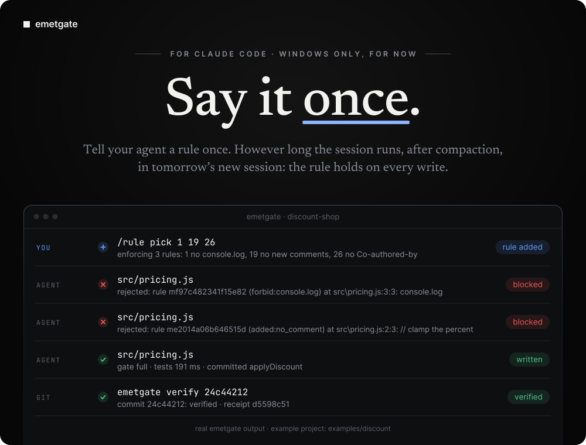
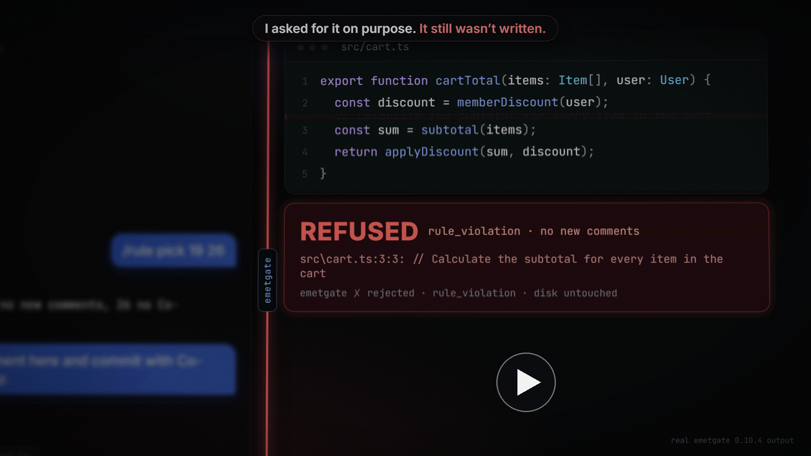
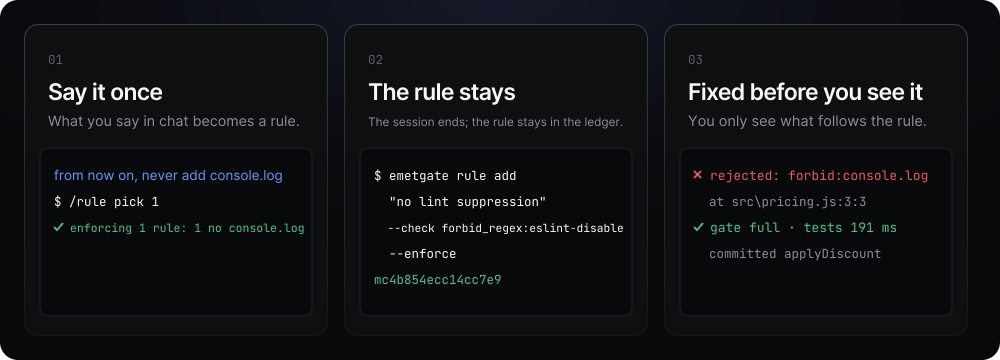
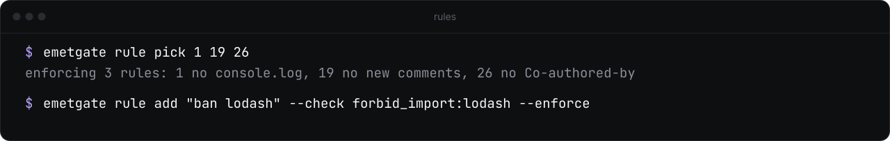
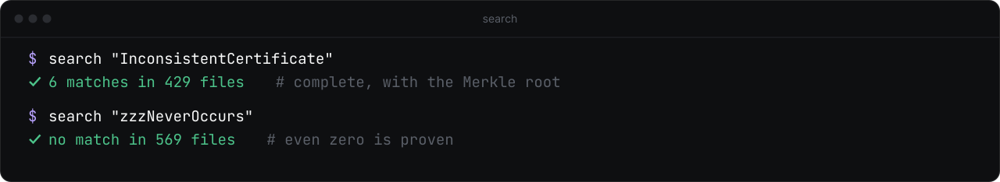
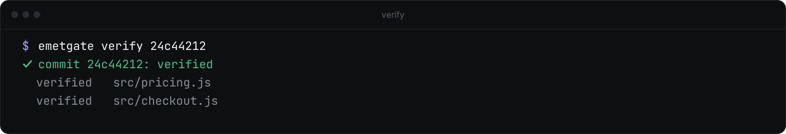

<p align="center">
  
</p>

<p align="center"><a href="../docs/QUICKSTART.md"><b>빠른 시작</b></a> · <a href="../REFERENCE.md"><b>레퍼런스</b></a> · <a href="../VERIFICATION.md"><b>검증</b></a> · <a href="../examples/discount"><b>실제 세션</b></a></p>

<p align="center"><sub><a href="../README.md">English</a> · <a href="README.tr.md">Türkçe</a> · <b>한국어</b> · <a href="README.zh-CN.md">简体中文</a> · <a href="README.es.md">Español</a></sub></p>

> [!NOTE]
> 현재는 Windows 전용입니다. Claude Code용으로 만들어졌으며 TypeScript, JavaScript, Python, C#, Zig 프로젝트에서 동작합니다.

에이전트에게 "주석을 달지 마"라고 말합니다. 한동안은 지킵니다. 그러다 세션이 길어지고, 컨텍스트가 압축되고, 다음 날 새 세션이 시작되면 같은 주석이 다시 나타납니다. CLAUDE.md에 적어 두어도 거기서도 부탁으로 남을 뿐입니다.

emetgate에서 규칙은 대화 안에 있지 않습니다. 별도의 규칙 장부에 있고, 에이전트의 모든 쓰기에 적용됩니다. 에이전트가 규칙을 어기면 쓰기는 디스크에 닿지 않습니다. 에이전트는 이유를 보고 같은 턴에서 고칩니다.

느낌이 아닙니다. Claude Code의 공식 문서도 같은 말을 합니다:

> *"CLAUDE.md instructions shape Claude's behavior but are not a hard enforcement layer."* CLAUDE.md 지시는 Claude의 행동을 형성하지만 강제하는 계층은 아닙니다. ([code.claude.com/docs/en/memory](https://code.claude.com/docs/en/memory))

<p align="center">
  <a href="../assets/video/emetgate-ad-en.mp4"></a>
  <br><sub>영상 보기: 에이전트에게 일부러 규칙을 어기라고 해도 게이트는 쓰지 않습니다.</sub>
</p>

## 동작 방식

<p align="center">
  
</p>

### 한 번만 말하세요

대화에서 지속적인 지시("앞으로는", "절대")를 내리면 emetgate는 에이전트에게 그것을 규칙으로 바꾸는 `/rule` 줄을 제안하라고 요청합니다. 확인하면 규칙이 됩니다. 직접 한 줄로 규칙을 쓸 수도 있습니다:

```
emetgate rule add "no lint suppression" --check forbid_regex:eslint-disable --enforce
```

또는 자주 쓰는 규칙이 들어 있는 기본 카탈로그에서 고릅니다: `console.log` 금지, 새 주석 금지, `Co-authored-by` 금지:



### 세션은 끝나도 규칙은 남습니다

규칙은 `.emetgate/` 아래의 장부에 있습니다. 세션이 아무리 길어져도, 압축된 뒤에도, 내일 새 세션에서도 같은 규칙이 모든 쓰기에 적용됩니다.

모든 프로젝트에 적용할 규칙은 전역 장부에 둡니다. `emetgate rule add` 또는 `emetgate rule pick`에 `--global`을 붙이세요. 이 장부는 어떤 저장소에도 속하지 않는 `%LOCALAPPDATA%\emetgate\rules`에 있고, 각 저장소의 자체 규칙과 함께 적용됩니다. 저장소는 이를 바꾸거나 지울 수 없습니다.

`emetgate lockdown`에서는 Claude Code 자체의 편집·쓰기 도구가 꺼집니다. 에이전트는 emetgate의 도구로 파일을 바꾸고, 모든 변경은 같은 규칙을 통과합니다. 에이전트에게는 규칙을 추가·변경·삭제할 도구가 없으며, 그렇게 하려는 명령은 먼저 사용자에게 묻습니다.

오래된 저장소에 규칙을 추가해도 아무것도 깨지지 않습니다. 새로운 위반만 거부됩니다.

### 보기 전에 고칩니다

거부는 줄과 열 정보와 함께 에이전트에게 돌아가고, 에이전트는 같은 턴에서 고칩니다. 사용자는 규칙을 따른 결과만 봅니다.

```
rejected: rule mf97c482341f15e82 (forbid:console.log) at src\pricing.js:3:3: console.log
rejected: rule me2014a06b646515d (added:no_comment) at src\pricing.js:2:3: // clamp the percent
```

## 왜 hook이나 ESLint로는 부족한가

Claude Code의 hook과 ESLint로 일부는 직접 만들 수 있습니다. 차이는 다음과 같습니다:

- **모든 쓰기 도구에 같은 게이트.** lockdown은 Claude Code 자체 편집 도구를 끕니다. 편집, 이름 바꾸기, 이동이 같은 규칙을 통과합니다. 에이전트가 셸 명령으로 파일을 바꾸면 기록되고, 고정된 경로는 되돌려지며, 게이트를 통과하지 않은 변경은 emetgate로 커밋할 수 없습니다.
- **에이전트는 ESLint를 끌 수 있습니다.** `eslint-disable` 줄과 `.eslintrc`는 에이전트가 편집할 수 있는 파일에 있습니다. emetgate의 규칙은 에이전트가 바꿀 도구가 없는 장부에 있으며, `eslint-disable`을 추가하는 것 자체도 규칙에 걸릴 수 있습니다.
- **변경은 전체로 검사됩니다.** 여러 파일을 건드리는 변경은 저장소 사본에서 한꺼번에 검사됩니다. 통과하면 모두 쓰이고, 아니면 아무것도 쓰이지 않습니다.
- **대화에서 규칙으로.** 지속적인 지시는 규칙으로 제안됩니다. 규칙마다 스크립트를 쓸 필요가 없습니다.

## 그 밖에

**검색은 무엇을 읽었는지 말합니다.** 에이전트가 "모든 사용처를 찾았다"고 할 때, 응답은 몇 개 파일을 스캔했고 모두 읽었는지 보여 줍니다. 숫자가 맞지 않으면 결과를 보여 주지 않습니다.



**커밋은 기록을 남깁니다.** 게이트를 거친 모든 커밋은 어떤 파일이 쓰였고 어떤 검사가 실행됐는지를 `refs/notes/emetgate`에 담습니다. 서명이 아니라 기록입니다. 나중에 무엇이 어떻게 쓰였는지 보여 줍니다.



신뢰하는 테스트 명령으로 커밋을 확인하세요. 영수증에 기록된 명령은 절대 다시 실행되지 않으므로 `--test` 없이는 커밋이 `unverified`로 남습니다:

```
emetgate verify HEAD --test "npm test"
```

**세션 비용 보기.** `emetgate report`는 프로젝트에서 emetgate 도구를 호출한 최근 세션을 요약합니다: 소요 시간, 모델 턴, input·output·cache 토큰, USD 기준 예상 비용, 이름별 도구 호출, 그리고 게이트가 한 일(적용·거부된 쓰기, 규칙 위반, 테스트 실행, 영수증, 커밋). `--session <id>`는 세션 하나를 고르고, `--all`은 모든 세션을 표로 보여 주며, `--json`은 같은 숫자를 JSON으로 출력합니다. 토큰은 Claude Code 자체 기록(`CLAUDE_CONFIG_DIR` 또는 `~/.claude` 아래 `projects/`)에서 가져오며, 비용은 모델별 내장 정가로 계산하므로 청구액이 아니라 추정치입니다.

**에이전트가 무엇을 건드리는지 보기.** `emetgate lockdown` 아래에서 emetgate 호출은 기록에 Claude Code 자체 도구처럼 보이며, 호출이 묶여도 마찬가지입니다: 읽은 줄과 함께 `Read(파일)`, 첫 결과와 함께 `Search("…")`, 바뀐 줄과 주변 줄과 함께 `Update(파일)`, `Write(파일)`, 출력과 함께 `Bash(명령)`. 읽기나 수정 옆의 얇은 띠는 에이전트가 지금까지 파일의 어느 부분을 봤는지 보여 주고, 읽지 않은 부분을 고치면 `edited without reading`으로 표시됩니다. 읽는 동안에는 띠가 파일을 훑고, 턴이 끝나면 한 줄이 턴을 요약하고 건드린 파일마다 얼마나 읽었는지를 나열합니다. 그리기만 합니다: 모델은 같은 응답을 받습니다. 비밀 파일(`.env`, 키, 자격 증명)은 이름만 보이고 내용은 절대 보이지 않습니다. `emetgate lockdown --no-marks`로 끕니다.

## 2분 만에 시작하기

PowerShell에서 실행한 뒤 새 터미널을 엽니다:

```
irm https://github.com/emetgate/emetgate/releases/latest/download/install.ps1 | iex
```

프로젝트 폴더에서:

```
emetgate doctor
emetgate rule pick 1 19 26
emetgate lockdown
```

`emetgate doctor`는 한 화면짜리 설치 점검입니다. 각 줄은 `ok`, `warn` 또는 `FAIL`과 해결 방법을 보여 줍니다: PATH가 실행하는 emetgate와 가려진 사본, 새 릴리스 여부, claude와 그것이 읽는 설정 폴더(`CLAUDE_CONFIG_DIR` 또는 `~/.claude`), emetgate가 MCP 서버로 등록된 위치, 실행 중인 다른 emetgate 프로세스, 데이터 폴더 크기, 그리고 이 폴더가 git 저장소인지. `--json`은 같은 내용을 JSON으로 출력합니다.

`emetgate lockdown`은 emetgate 도구만으로 Claude Code를 시작합니다. 홈 폴더나 드라이브 루트가 아니라 프로젝트 폴더(git 저장소) 안에서 실행하세요. 단계별 안내: [docs/QUICKSTART.md](../docs/QUICKSTART.md).

## 제거

```
emetgate uninstall
emetgate uninstall --yes
```

첫 번째 명령은 아무것도 지우지 않습니다: 프로그램 폴더(`%LOCALAPPDATA%\Programs\emetgate`), 사용자 PATH의 항목, 데이터 폴더(`%LOCALAPPDATA%\emetgate`, 몇 GB까지 커질 수 있는 캐시)를 크기와 함께 보여 줍니다. `--yes`는 이것들을 지우고, 데이터 폴더를 남기려면 `--keep-cache`를 붙이세요. 실행 중인 emetgate.exe는 자신을 지울 수 없으므로 프로그램 폴더는 명령이 끝나고 몇 초 뒤에 사라집니다. 다른 emetgate 프로세스가 실행 중이면 PID를 보여 주고, 그것들을 닫을 때까지 아무것도 지우지 않습니다. 각 프로젝트의 `.emetgate` 폴더와 `.mcp.json` 항목은 남으니 직접 지우세요.

### 디스크 사용량

emetgate는 프로젝트별 캐시(검색 인덱스, 사실 정보, 테스트가 실행되는 사본)를 `%LOCALAPPDATA%\emetgate` 아래에 둡니다. 서버는 하루에 한 번 30일 동안 쓰이지 않은 캐시를 지웁니다. 직접 확인하고 줄이려면:

```
emetgate cache size                  # total, per folder and per project (--json for scripts)
emetgate cache prune --dry-run       # what would go, nothing deleted
emetgate cache prune                 # remove caches unused for 14 days (--older-than <days>)
emetgate cache prune --all           # remove every cache no running emetgate is using
```

실행 중인 emetgate가 임대한 캐시는 절대 지워지지 않습니다. 공유 `cache`와 `run-tmp` 폴더(패키지 캐시와 샌드박스 명령의 TEMP)는 `--all`로만, 그리고 다른 emetgate 프로세스가 실행 중이지 않을 때만 비워집니다.

## 한계

- 현재는 Windows 전용입니다.
- 규칙은 emetgate의 쓰기 도구를 거친 변경에 적용됩니다. 에이전트가 실행한 명령은 게이트를 거치지 않습니다. 바꾼 파일은 보고되고 고정된 경로는 되돌려지지만, 다른 규칙은 명령에 적용되지 않습니다.
- 규칙 장부는 `.emetgate/` 아래의 파일입니다. 에이전트에게는 그것을 쓸 도구가 없지만, 명령으로 편집하는 경우는 규칙 명령을 감시하는 hook에 걸리지 않습니다.
- lockdown 밖에서 에이전트 자체 도구로 연 세션에는 게이트가 없습니다. MCP를 쓰는 다른 에이전트에서는 에이전트가 emetgate 도구를 쓰는 동안 게이트가 동작합니다.
- 쓰기 한 번에 게이트에서 약 0.2–0.4 s가 걸립니다. 토큰 절감은 약속하지 않습니다.
- 영수증은 서명되지 않습니다. 커밋과 맞지 않게 수정된 영수증은 잡지만, 처음부터 다시 쓴 이력은 잡지 못합니다.
- 파괴적 명령 검사는 단어를 봅니다. 샌드박스가 아닙니다.

## 내부 구조

<details>
<summary>게이트: 사본에서 재파싱, 규칙, 타입 검사, 테스트 후 한 번에 쓰기</summary>

변경은 심볼과 그 변경이 기반한 코드의 해시를 지정합니다. emetgate는 새 본문을 넣고, 파일을 다시 파싱하고, 규칙을 실행한 뒤, 저장소 사본의 저권한 샌드박스 안에서 타입 검사와 테스트를 실행합니다. 모든 단계를 통과하면 쓰고, 하나라도 실패하면 아무것도 쓰지 않습니다. 쓰기는 저널을 거치며, 중간에 끊기면 `emetgate recover`가 복구합니다.

</details>

<details>
<summary>규칙: 구문 트리 쿼리, 패턴, 명령, 고정 경로, 커밋 메시지</summary>

규칙 검사는 구문 트리 쿼리(`no_comment`, `require_comment`, `max_function_lines`, `forbid_import`), 변경 범위에서의 단계 제한 regex(`forbid_regex`, `no_todo`), 명령, 고정 경로, 커밋 메시지 검사(`message:conventional`, Co-authored-by 금지)입니다. 장부 `ledger.ndjson`은 추가만 가능하며, 모델은 읽을 수 있지만 쓸 도구가 없습니다. lockdown의 대화 hook은 `/rule` 줄을 모델에 닿기 전에 처리하고, 지속적인 지시를 규칙으로 바꾸도록 제안합니다.

</details>

<details>
<summary>검색과 검증: 사용하는 기법</summary>

검색은 suffix array 인덱스와 trigram 목록을 사용합니다. 읽은 모든 파일의 SHA-256 위에 RFC 9162 Merkle 루트를 계산해 응답이 완전한지 부분적인지 보여 주며, ripgrep과 줄 단위로 비교됩니다. 커밋 기록은 in-toto 형식이고, `emetgate verify --branch main..HEAD --test "<cmd>"`는 범위 전체를 검사합니다. 영수증이 없는 커밋은 `partial`로 처리됩니다. 자세한 내용: [REFERENCE.md](../REFERENCE.md), [VERIFICATION.md](../VERIFICATION.md).

</details>

## 이름의 유래

프라하 전설에서 골렘은 이마에 쓰인 **אמת**(*emet*, "진리")라는 단어로 살아납니다. 첫 글자를 지우면 **מת**(*met*, "죽음")가 되어 멈춥니다. emetgate에서도 규칙을 어기는 변경은 쓰이지 않습니다.

MIT. [LICENSE](../LICENSE) 참조.
