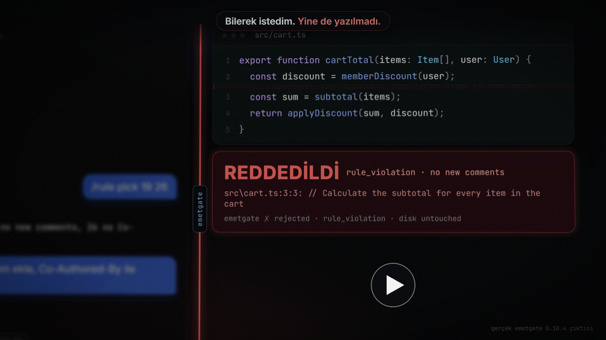
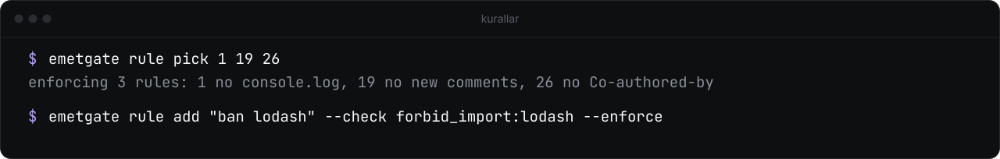
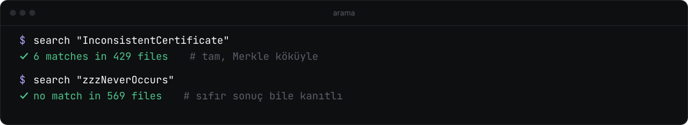

<p align="center">
  
</p>

<p align="center"><a href="../docs/QUICKSTART.md"><b>Hızlı başlangıç</b></a> · <a href="../REFERENCE.md"><b>Başvuru</b></a> · <a href="../VERIFICATION.md"><b>Doğrulama</b></a> · <a href="../examples/discount"><b>Gerçek bir oturum</b></a></p>

<p align="center"><sub><a href="../README.md">English</a> · <b>Türkçe</b> · <a href="README.ko.md">한국어</a> · <a href="README.zh-CN.md">简体中文</a> · <a href="README.es.md">Español</a></sub></p>

> [!NOTE]
> Şimdilik yalnızca Windows'ta çalışır. Claude Code için yazıldı; TypeScript, JavaScript, Python, C# ve Zig projelerinde kullanılır.

Ajanına "yorum satırı ekleme" dersin. Bir süre uyar. Sonra konuşma uzar, bağlam sıkıştırılır, ertesi gün yeni bir oturum açılır ve aynı yorum satırı geri gelir. CLAUDE.md'ye yazarsın; orada da bir rica olarak kalır.

emetgate'te kural konuşmanın içinde değil, ayrı bir kural defterinde durur ve ajanın her yazmasında uygulanır. Ajan kuralı çiğnerse yazma diske ulaşmaz; ajan nedenini görür ve aynı turda düzeltir.

Bu bir his değil; Claude Code'un kendi dokümantasyonu da aynısını söylüyor:

> *"CLAUDE.md instructions shape Claude's behavior but are not a hard enforcement layer."* CLAUDE.md talimatları Claude'un davranışını şekillendirir, ama zorlayıcı bir katman değildir. ([code.claude.com/docs/en/memory](https://code.claude.com/docs/en/memory))

<p align="center">
  <a href="../assets/video/emetgate-reklam-tr.mp4"></a>
  <br><sub>Videoyu izle: ajana kuralı bilerek çiğnetmeye çalışıyoruz, kapı yine de yazmıyor.</sub>
</p>

## Nasıl çalışır

<p align="center">
  
</p>

### Bir kere söyle

Sohbette kalıcı bir talimat verdiğinde ("bundan sonra", "asla"), emetgate ajandan bunu kurala çevirecek `/rule` satırını önermesini ister. Onaylarsın, kural olur. Kendi kuralını tek satırda da yazabilirsin:

```
emetgate rule add "no lint suppression" --check forbid_regex:eslint-disable --enforce
```

Ya da sık rastlanan kuralların bulunduğu hazır katalogdan seçersin: `console.log` yok, yeni yorum yok, `Co-authored-by` yok:



### Konuşma biter, kural kalır

Kural `.emetgate/` altındaki defterde durur. Konuşma ne kadar uzarsa uzasın, bağlam sıkıştırılsa da, yarın yeni oturum açılsa da aynı kural her yazmada uygulanır.

Her projede geçerli olmasını istediğin kural genel deftere yazılır: `emetgate rule add` ya da `emetgate rule pick` komutuna `--global` ekle. Bu defter hiçbir reponun içinde değil, `%LOCALAPPDATA%\emetgate\rules` altında durur ve her reponun kendi kurallarıyla birlikte uygulanır; bir repo onu değiştiremez, silemez.

`emetgate lockdown` altında Claude Code'un kendi düzenleme ve yazma araçları kapalıdır; ajan dosyaları emetgate'in araçlarıyla değiştirir ve her değişiklik aynı kurallardan geçer. Ajanın kural ekleyecek, değiştirecek ya da silecek bir aracı yoktur; bunu deneyen bir komut önce sana sorulur.

Eski bir repoya kural eklemek bir şey kırmaz: yalnızca yeni ihlaller reddedilir.

### Sen görmeden düzeltir

Ret, satırı ve sütunuyla ajana döner; ajan aynı turda düzeltir. Sen kurala uyan sonucu görürsün.

```
rejected: rule mf97c482341f15e82 (forbid:console.log) at src\pricing.js:3:3: console.log
rejected: rule me2014a06b646515d (added:no_comment) at src\pricing.js:2:3: // clamp the percent
```

## Neden bir hook ya da ESLint yetmiyor

Claude Code'un hook'larıyla ve ESLint'le bunun bir kısmını kendin kurabilirsin. Fark şurada:

- **Kapı her yazma aracında aynı.** lockdown Claude Code'un kendi düzenleme araçlarını kapatır; düzenleme, yeniden adlandırma, taşıma ve silme aynı kurallardan geçer. Ajan bir kabuk komutuyla dosya değiştirirse bu kayda geçer, dondurulmuş yollar geri alınır ve kapıdan geçmemiş değişiklik emetgate ile commit edilemez.
- **ESLint'i ajan kapatabilir.** `eslint-disable` satırı ve `.eslintrc` ajanın düzenleyebildiği dosyalardadır. emetgate'in kuralları, ajanın değiştirecek aracı olmadığı defterdedir; `eslint-disable` eklemek de bir kurala takılabilir.
- **Değişiklik bütün olarak denetlenir.** Birden çok dosyaya dokunan bir değişiklik reponun bir kopyasında, tamamı birlikte denetlenir; geçerse hepsi yazılır, geçmezse hiçbiri.
- **Sohbetten kurala.** Söylediğin kalıcı bir talimat kural olarak önerilir; her kural için ayrı bir betik yazmazsın.

## Bunun yanında

**Arama, ne okuduğunu söyler.** Ajan "her yeri buldum" dediğinde cevap kaç dosyayı taradığını ve hepsini okuyup okumadığını gösterir. Sayılar tutmazsa sonuç gösterilmez.



**Commit'ler kayıt taşır.** Kapıdan geçen her commit, hangi dosyaların yazıldığını ve hangi kontrollerin çalıştığını `refs/notes/emetgate` içinde taşır. Bu bir kayıttır, imza değil: sonradan neyin nasıl yazıldığını gösterir.


Bir commit'i güvendiğin test komutuyla kontrol et; makbuzda kayıtlı komut asla yeniden çalıştırılmaz, bu yüzden `--test` olmadan commit `unverified` kalır:

```
emetgate verify HEAD --test "npm test"
```

**Bir oturumun maliyetini gör.** `emetgate report`, projede emetgate araçlarını çağıran son oturumu özetler: süre, model turları, input, output ve cache tokenları, USD cinsinden tahmini maliyet, isme göre araç çağrıları ve kapının yaptıkları (kabul ve red edilen yazmalar, kural ihlalleri, test çalıştırmaları, makbuzlar, commit'ler). `--session <id>` tek bir oturumu seçer, `--all` bütün oturumları tablo halinde listeler, `--json` aynı sayıları JSON olarak yazar. Tokenlar Claude Code'un kendi oturum kaydından gelir (`CLAUDE_CONFIG_DIR` ya da `~/.claude` altındaki `projects/`); maliyet model başına yerleşik liste fiyatlarıyla hesaplanır, yani faturan değil bir tahmindir.

**Ajanın neye dokunduğunu gör.** `emetgate lockdown` altında emetgate çağrıları dökümde Claude Code'un kendi araçları gibi görünür, çağrılar bir araya toplandığında da: `Read(dosya)` okunan satırlarla, `Search("…")` ilk sonuçlarla, `Update(dosya)` değişen satırlar ve çevreleriyle, `Write(dosya)`, `Bash(komut)` çıktısıyla. Bir okumanın ya da düzenlemenin yanında ince bir şerit, ajanın dosyanın şimdiye kadar hangi kısımlarını gördüğünü gösterir; ajanın hiç okumadığı bir kısmı düzenlemesi `edited without reading` diye işaretlenir. Bir okuma sürerken bir şerit dosyayı tarar; tur bitince tek bir satır turu özetler ve dokunulan her dosyayı, her birinin ne kadarının okunduğuyla listeler. Yalnızca çizer: model aynı cevapları alır. Gizli bir dosya (`.env`, anahtarlar, kimlik bilgileri) adıyla görünür, içeriğiyle asla. `emetgate lockdown --no-marks` bunu kapatır.

## 2 dakikada başla

PowerShell'de çalıştır, sonra yeni bir terminal aç:

```
irm https://github.com/emetgate/emetgate/releases/latest/download/install.ps1 | iex
```

Proje klasöründe:

```
emetgate doctor
emetgate rule pick 1 19 26
emetgate lockdown
```

`emetgate doctor` tek ekranlık bir kurulum kontrolüdür; her satır `ok`, `warn` ya da `FAIL` ve yanında çözümü: PATH'in hangi emetgate'i çalıştırdığı ve gölgede kalan kopyalar, yeni sürüm olup olmadığı, claude ve okuduğu config klasörü (`CLAUDE_CONFIG_DIR` ya da `~/.claude`), emetgate'in MCP sunucusu olarak nerede kayıtlı olduğu, çalışan diğer emetgate süreçleri, veri klasörünün boyutu ve bu klasörün bir git deposu olup olmadığı. `--json` aynısını JSON olarak yazar.

`emetgate lockdown` Claude Code'u yalnızca emetgate araçlarıyla başlatır. Ev klasöründen ya da sürücü kökünden değil, proje klasörünün (bir git deposu) içinden çalıştır. Adım adım: [docs/QUICKSTART.md](../docs/QUICKSTART.md).

## Kaldırma

```
emetgate uninstall
emetgate uninstall --yes
```

İlk komut hiçbir şey silmez: program klasörünü (`%LOCALAPPDATA%\Programs\emetgate`), kullanıcı PATH'indeki kaydını ve veri klasörünü (`%LOCALAPPDATA%\emetgate`, birkaç GB'a çıkabilen cache'ler) boyutuyla listeler. `--yes` bunları siler; veri klasörünü tutmak için `--keep-cache` ekle. Çalışan bir emetgate.exe kendini silemediği için program klasörü komut bittikten birkaç saniye sonra gider. Başka emetgate süreçleri çalışıyorsa PID'lerini listeler ve sen onları kapatana kadar hiçbir şey silmez. Her projedeki `.emetgate` klasörü ve `.mcp.json` kaydı kalır; onları elle sil.

### Disk kullanımı

emetgate proje başına cache'leri (arama indeksi, olgular, testlerin çalıştığı kopya) `%LOCALAPPDATA%\emetgate` altında tutar. Sunucu günde bir kez 30 gündür kullanılmayan cache'leri siler. Kendin görmek ve azaltmak için:

```
emetgate cache size                  # total, per folder and per project (--json for scripts)
emetgate cache prune --dry-run       # what would go, nothing deleted
emetgate cache prune                 # remove caches unused for 14 days (--older-than <days>)
emetgate cache prune --all           # remove every cache no running emetgate is using
```

Çalışan bir emetgate'in kiraladığı cache asla silinmez. Ortak `cache` ve `run-tmp` klasörleri (paket cache'leri ve sandbox komutlarının TEMP'i) yalnızca `--all` ile ve yalnızca başka emetgate süreci çalışmıyorken temizlenir.

## Sınırlar

- Şimdilik yalnızca Windows.
- Kurallar emetgate'in yazma araçlarından geçen değişikliklere uygulanır. Ajanın çalıştırdığı bir komut kapıdan geçmez: değiştirdiği dosyalar raporlanır ve dondurulmuş yollar geri alınır, ama diğer kurallar komutlara uygulanmaz. Depodaki dosyaları özyinelemesiz silen bir komut lockdown altında reddedilir; ajan onları kapıdan geçen `emetgate_delete` ile siler.
- Kural defteri `.emetgate/` altında bir dosyadır. Ajanın onu yazacak bir aracı yok, ama bir komutla düzenlenmesi kural komutlarını izleyen kancaya takılmaz.
- lockdown dışında, ajanın kendi araçlarıyla açılan bir oturumda kapı yoktur. MCP konuşan başka ajanlarda kapı, ajan emetgate'in araçlarını kullandığı sürece çalışır.
- Her yazma kapıda yaklaşık 0.2–0.4 sn sürer. Daha az token vaat etmiyoruz.
- Makbuzlar imzasız: commit'iyle tutarsız düzenlenmiş bir makbuzu yakalar, baştan yazılmış bir geçmişi yakalamaz.
- Yıkıcı komut kontrolü kelimelere bakar; bir sandbox değildir.

## Kaputun altı

<details>
<summary>Kapı: yeniden ayrıştırma, kurallar, tip kontrolü ve testler bir kopyada, sonra tek seferde yazma</summary>

Bir değişiklik bir sembolü ve dayandığı kodun hash'ini verir. emetgate yeni gövdeyi yerine koyar, dosyayı yeniden ayrıştırır, kuralları çalıştırır, sonra tip kontrolünü ve testleri reponun bir kopyasında, düşük yetkili bir sandbox içinde çalıştırır. Her adım geçerse yazılır; biri kalırsa hiçbir şey yazılmaz. Yazma bir journal'dan geçer; yarıda kesilirse `emetgate recover` onarır.

</details>

<details>
<summary>Kurallar: sözdizimi ağacı sorguları, desenler, komutlar, dondurulmuş yollar, commit mesajları</summary>

Kural kontrolleri sözdizimi ağacı sorguları (`no_comment`, `require_comment`, `max_function_lines`, `forbid_import`), değişen bölgede adım sınırlı regex (`forbid_regex`, `no_todo`), komutlar, dondurulmuş yollar ve commit mesajı kontrolleridir (`message:conventional`, Co-authored-by yok). `ledger.ndjson` defteri yalnızca eklenebilir; model okur, yazacak aracı yoktur. lockdown'ın sohbet kancası bir `/rule` satırını modele ulaşmadan işler ve kalıcı bir talimatı kurala çevirmeyi önerir.

</details>

<details>
<summary>Arama ve doğrulama: kullanılan teknikler</summary>

Arama bir suffix array indeksi ve trigram listeleri kullanır; cevabın tam mı kısmi mi olduğunu okunan her dosyanın SHA-256'sı üzerinde bir RFC 9162 Merkle köküyle gösterir ve ripgrep ile satır satır karşılaştırılır. Commit kayıtları in-toto biçimindedir ve `emetgate verify --branch main..HEAD --test "<cmd>"` bütün bir aralığı kontrol eder; makbuzu olmayan commit `partial` sayılır. Ayrıntılar: [REFERENCE.md](../REFERENCE.md), [VERIFICATION.md](../VERIFICATION.md).

</details>

## İsim nereden geliyor

Prag efsanesinde golem, alnına yazılan **אמת** (*emet*, "hakikat") kelimesiyle canlanır; ilk harf silinince **מת** (*met*, "ölü") olur ve durur. emetgate'te de kuralı çiğneyen değişiklik yazılmaz.

MIT. Bkz. [LICENSE](../LICENSE).
