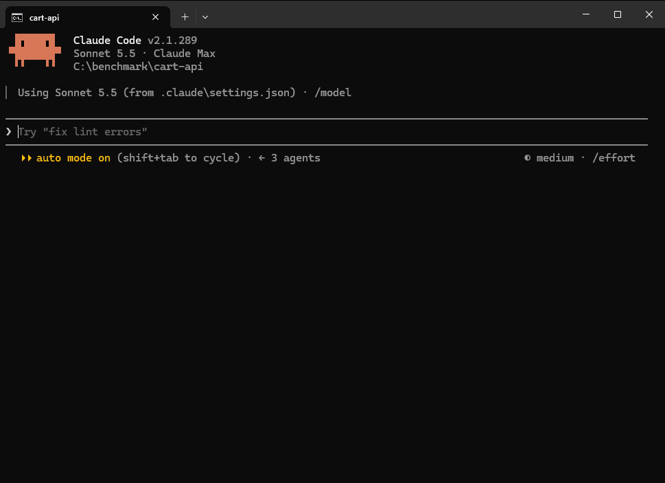

<p align="center">
  
</p>

<p align="center">
  
  
  
  <a href="https://github.com/emetgate/emetgate/actions/workflows/ci.yml"></a>
  <a href="https://github.com/emetgate/emetgate/releases/latest"></a>
</p>

<p align="center"><a href="../README.md">English</a> · <b>Türkçe</b> · <a href="README.ko.md">한국어</a> · <a href="README.zh-CN.md">简体中文</a> · <a href="README.es.md">Español</a></p>

# Emetgate

`CLAUDE.md` dosyana "yorum satırı yok" ve "Co-Authored-By yok" yazıyorsun. Model bir süre uyuyor, sonra bırakıyor. Daha uzun bir dosya yalnızca bir kez daha rica eder.

Emetgate, Claude Code ile kaynak kodun arasına girer. Model bir değişiklik önerir, kuralların ve testlerin bunu deponun bir kopyasında yargılar, dosya ancak geçerse değişir. Koyduğun kural, oturum ne kadar uzarsa uzasın ve kuralı çiğnemeyi modelden sen istesen bile, her yazma aracı çağrısında ve her `emetgate_commit` çağrısında denetlenir. Geçen her değişiklik, sonradan kontrol edebileceğin bir makbuz bırakır.

```
"status":"rejected","reason":"rule_violation"
"rule_text":"no new comments","file":"src\\cart.js","line":18
"text":"// apply the coupon before tax"
emetgate ✗ rejected · rule_violation · disk untouched · session 0 edits
```

Emetgate bir tanıktır, garanti değildir. Neyin çalıştığını ve ne olduğunu söyler; kodun doğru ya da güvenli olduğunu söyleyemez. Bkz. [Sınırlar](#sınırlar).

Yalnızca Windows. [Claude Code](https://claude.ai/code) ve Git gerekir.

<p align="center"></p>

## Başlangıç

Binary'yi indir ve `PATH`'e ekle (PowerShell):

```
New-Item -ItemType Directory -Force "$env:USERPROFILE\emetgate" | Out-Null
Invoke-WebRequest "https://github.com/emetgate/emetgate/releases/latest/download/emetgate.exe" -OutFile "$env:USERPROFILE\emetgate\emetgate.exe"
[Environment]::SetEnvironmentVariable("Path", [Environment]::GetEnvironmentVariable("Path", "User") + ";$env:USERPROFILE\emetgate", "User")
```

Sonra yeni bir terminal aç, proje klasörüne geç ve çalıştır:

```
emetgate lockdown
```

Kurulumun tamamı bu. Kendi kurallarını tutturmak için oturumda şunu yaz. Burada 19 yeni yorum yok, 26 Co-authored-by yok demek; `/rule pick` 30 kuralın hepsini listeler:

```
/rule pick 19 26
```

Buradaki diğer satırlar isteğe bağlı:

| amaç | komut | ne yapar |
| --- | --- | --- |
| oturum başlatmak | `emetgate lockdown` | Claude Code'u yerleşik araçları yerine emetgate araçlarıyla açar; test komutu her yazmada algılanır |
| kurulumu kontrol etmek | `emetgate doctor` | her kontrol için bir satır; her `FAIL` onu düzelten komutla biter |
| test komutunu belirtmek | `claude mcp add --scope project emetgate -- emetgate mcp --test "npm test"` | algılama bir şey bulamazsa ya da yanlış komutu bulursa; `.mcp.json` yazar |
| typecheck eklemek | aynı satır, `--typecheck "npx tsc --noEmit"` ile | `tsc` algılanmaz, adının verilmesi gerekir |
| indirmeyi kontrol etmek | `Get-FileHash "$env:USERPROFILE\emetgate\emetgate.exe" -Algorithm SHA256` | release sayfasındaki `emetgate.exe.sha256` ile karşılaştır |
| kaynaktan derlemek | `zig build -Doptimize=ReleaseSafe` | Zig 0.16.0 gerekir |

Her release bir SHA-256 dosyası ve build provenance attestation ile gelir. Binary henüz kod imzalı değil. Adım adım: [docs/QUICKSTART.md](../docs/QUICKSTART.md).

## Oturumda ne değişir

| model şunu isterse | olan |
| --- | --- |
| okumak ya da aramak | izin sormadan, dosyanın tamamından daha az metin gönderen araçlarla çalışır |
| komut çalıştırmak | her komut çalışır, uzun çıktı kırpılarak döner |
| yıkıcı komut çalıştırmak | önce sana sorulur: `rm -rf`, `git reset --hard`, `git push --force`, `DROP TABLE`, disk biçimlendirme, indirilen bir betiği shell'e aktarmak ve benzerleri |
| dosya değiştirmek | her zamanki gibi sorulur, sonra değişiklik kapıdan geçer |

Boş klasörde `git init` yapılır. Sürücü kökü, ev klasörün, sistem klasörü ya da çok büyük bir klasörde yapılmaz; lockdown orada reddeder. Zaten deposu olan klasöre dokunulmaz.

## Kapı

```
proposal ─▶ reparse ─▶ rules ─▶ typecheck ─▶ tests ─▶ write + receipt  (אמת)
                  └── a step fails ─▶ nothing is written (מת)
```

Kod değişikliği bir sembolü ve dayandığı kodun hash'ini belirtir, böylece eskimiş bir düzenleme reddedilir. Değişiklik deponun bir kopyasına uygulanır ve adımlar orada çalışır. Bir adım başarısız olursa dosyaların olduğu gibi kalır ve yanıt her başarısız testin çıktısını taşır; model tüm testleri yeniden çalıştırmadan düzeltebilir.

Her adımın yaptığı ve yapmadığı:

| adım | ne zaman çalışır | not |
| --- | --- | --- |
| reparse | her zaman, ayrıştırıcısı olan dillerde | dosyanın hâlâ ayrıştırıldığını gösterir |
| kurallar | kuralın varsa | bkz. [Kurallar](#kurallar) |
| typecheck | proje mypy ya da pyright yapılandırmışsa, kökünde tek bir `dotnet` projesi varsa ya da `--typecheck` ile | `tsc` algılanmaz; `--typecheck` ile ver |
| testler | test komutu bulunduysa ve kod değiştiyse | test komutu yoksa yazma `unverified_no_tests` işaretiyle yapılır; yalnızca kod dışı dosya değiştiyse test çalışmaz |
| makbuz | geçen her yazmada | bkz. [Makbuzlar](#makbuzlar) |

Kapının test kuralı şudur: **daha önce başarısız olmayan hiçbir test başarısız olamaz.** Zaten başarısız olan bir test yazmayı engellemez, yanıt onu belirtir (`baseline_failing`, `failing_tests`). pytest ve `dotnet test`, yeni başarısız bir testin `emetgate_commit`'e kadar kalmasına da izin verir; borç `tests/debt.json` içinde tutulur, böylece önce testi yazıp sonra geçirebilirsin. Analizin kendi sembolünün dışına çıkamayacağını kanıtladığı bir değişiklik, yapılandırılmışsa tüm testler yerine kapsamlı bir test komutu çalıştırır.

## Diller

| | read, try, scan, kurallar | rename | move, move_file | çağrı grafiği (`facts`) | `explore`, `map` |
| --- | :-: | :-: | :-: | :-: | :-: |
| TypeScript, TSX, JavaScript | evet | evet | evet | evet | evet |
| Python | evet | evet | evet | evet | `map` evet, `explore` kısmi |
| C# | evet | evet | tipler ve statik üyeler | kısmi | `map` evet, `explore` kısmi |
| Zig | evet (üst düzey fonksiyonlar) | hayır | hayır | hayır | hayır |
| JSON, Markdown | bölüm okuma ve yazma | - | - | - | - |

`map`, Python ve C# testlerini, route'larını ve komutlarını tanır. `explore` bazı isimleri hâlâ yanlışlıkla test sanıyor, örneğin `latest_news.py`. Rename, tipsiz bir yerel değişken üzerinden çağrılan metodu izleyemez. C# örnek üyesi taşınmaz, çünkü nesnesine bağlıdır. Dekoratörlü ya da üst düzey ifadeler içeren bir dosyadan Python sembolü taşımak `order_change:true` ister. Python ve C# için dil servisi yok. İkisinin de eşitlik çalışması sürüyor.

Test komutları şunlardan algılanır: `package.json`, `build.zig`, `Cargo.toml`, `go.mod`, Python proje işaretleri, `.sln`, `.slnx`, `.csproj`, `.fsproj`, `.vbproj` ve iç içe test projeleri.

## Araçlar

Model 23 araç alır. Tüm parametreler: [REFERENCE.md](../REFERENCE.md).

| | araçlar |
| --- | --- |
| anlamak | `explore` (bir sorudan tanıma, çağıranlara ve etkiye), `evidence`, `symbols`, `skeleton` |
| okumak | `read_symbol`, `read_file` (tek çağrıda en fazla 32 dosya, JSON pointer, Markdown başlığı, satır aralığı), `list` |
| aramak | `search` (literal ya da regex, takipli dosyalarda), `find` (herhangi bir dosyada büyük-küçük harf duyarsız literal) |
| kod değiştirmek | `try`, `try_batch` (çok dosya, ya hepsi ya hiçbiri), `edit`, `write`, `rename`, `move`, `move_file` |
| belge değiştirmek | `write_doc` (JSON, Markdown, aralıklar) |
| denetlemek | `scan` (depo üzerinde tek bir denetim), `mutate` (önizleme) |
| git ve shell | `git` (salt okunur), `git_write` (bayrak izin listesi; kayıp `force: true` ister), `commit` (makbuzla), `run` |

Senin için komut satırı araçları: `doctor`, `verify`, `rule`, `rules` (terminal arayüzü), `recover`, `commit`, `receipts attach`, `facts`, `map`, `find`, `scan`, `stats`.

## Kurallar

`--enforce` ile koyduğun kural her yazmada tutulur; onsuz kural yalnızca kaydedilir ve gösterilir. Model kuralları okuyabilir, değiştiremez; onları değiştirecek bir komut önce sana sorar. Kurallar yalnızca sona ekleme yapılan `.emetgate/ledger.ndjson` dosyasında durur.

**Kural koymak.** `/rule` satırları prompt gönderilmeden işlenir, modele hiç ulaşmaz.

| nerede | komut | ne yapar |
| --- | --- | --- |
| oturumda | `/rule pick` | aşağıdaki 30 hazır kuralı gösterir |
| oturumda | `/rule pick 1 19 26 in src/` | bu kuralları benimser, burada yalnızca `src/` altında |
| oturumda | `/rule add "ban lodash" --check forbid_import:lodash --enforce` | kendi kuralını ekler |
| oturumda | `/rule list`, `/rule supersede <id> "new text"`, `/rule forget <id>` | kuralı gösterir, değiştirir ya da kullanımdan kaldırır |
| terminalde | `emetgate rule add ...` | aynı komutlar, eğik çizgisiz |
| terminalde | `emetgate rules` | aynı kurallar için terminal arayüzü |

`--in`, kuralı bir dosyayla, `/` ile biten bir klasörle ya da `file#symbol` ile sınırlar.

**Bir kural neyi denetleyebilir.**

| denetim | yazma şu durumda reddedilir |
| --- | --- |
| `no_comment` | yorum içeriyorsa |
| `require_comment` | fonksiyon, metot ya da sınıfın önünde yorum yoksa |
| `no_todo` | `TODO`, `FIXME` ya da `XXX` içeriyorsa |
| `forbid:<text>` | bu metni içeriyorsa |
| `require:<text>` | bu metni içermiyorsa |
| `forbid_regex:<pattern>` | bu regex eşleşiyorsa |
| `no_literal:<option>` | bu seçeneği sabit yazıyorsa, örn. `timeout: 30000` üzerinde `no_literal:timeout` |
| `forbid_import:<module>` | bu modülü içe aktarıyorsa |
| `max_function_lines:<n>` | bir fonksiyon n satırdan uzunsa |
| `q:<query>` | bu tree-sitter sorgusu eşleşiyorsa |
| `added:<check>` | denetim yalnızca değişikliğin eklediklerinde başarısızsa; eski kod yazmayı engellemez |
| `cmd:<command>` | sandbox'taki kopyada çalışan kendi komutun ihlal bildirirse |
| `frozen` | kuralın `--in` kapsamındaki bir yolu değiştiriyorsa |
| `message:<check>` | commit mesajı şunu çiğniyorsa: `forbid`, `require`, `max_lines`, `max_subject`, `max_line`, `conventional` |

**`/rule pick` içindeki hazır kurallar.**

| grup | kurallar |
| --- | --- |
| kod stili, JS ve TS | `console.log`, `debugger`, `alert`, `var`, `any`, `document.write`, `innerHTML`, `dangerouslySetInnerHTML`, odaklı testler (`.only`), `@ts-ignore` yok |
| kod stili, Python | `print`, `exec`, `assert`, çıplak `except`, `pickle` yok |
| kod stili, C# | `Console.WriteLine`, `Debug.WriteLine`, `Thread.Sleep` yok |
| kod stili, her dil | yeni yorum yok, tanımlarda doc comment, fonksiyonlar en fazla 50 satır, `TODO`/`FIXME`/`XXX` yok |
| güvenlik | `eval`, sabit yazılmış sırlar (regex ile), `http://` URL'leri yok |
| git düzeni | `Co-authored-by` yok, "Generated with Claude" yok, `WIP` yok, conventional commit başlığı |
| mimari | bir yolu dondur |

`frozen` bir yol yazma araçlarıyla değişemez ve `emetgate_run` her komuttan sonra onu geri koyar. `emetgate_run` üzerinden `git commit` önce sana sorar.

## Makbuzlar

Geçen bir yazma, neyin neyden ve hangi testlerle üretildiğini anlatan bir [in-toto](https://in-toto.io) kaydına bağlanır. `emetgate_commit` bunu `refs/notes/emetgate` altında git notu olarak saklar.

```
$ emetgate verify --branch main..HEAD
branch partial: 48 commit(s)          # no receipt: not called verified
  a179a7f unverified (no receipt)  cert 84c2…

# after tampering with one receipt:
branch broken: 1 commit(s)
  3ff23a0 MISMATCH  cert ec79…
```

Bir commit `verified`, `merged`, `unverified` ya da `mismatch` olur; bir aralık `verified`, `partial`, `broken` ya da `empty` olur ve boş aralık başarısız sayılır. `tools/verify_py/emetgate_verify.py` makbuzları Python'da bağımsız olarak denetler.

Makbuzlar imzalı değildir ve zincirin ucu yayımlanmaz. Bu, commit'iyle tutarsız düzenlenmiş bir makbuzu yakalar. Yeni ve tutarlı bir makbuzla birlikte yeniden yazılmış bir commit'i yakalamaz.

## Arama

İki arama aracı var ve ikisi de dosyanın tamamını geri göndermez.

| | `search` | `find` |
| --- | --- | --- |
| nereye bakar | `dir` altındaki git takipli metin dosyaları | git'in listelediği her dosya, takipli ya da takipsiz, yok sayılmamış |
| neyi eşler | büyük-küçük harf duyarlı literal ya da `regex:true` ile regex | her harf büyüklüğünde literal, her bayt, her dil |
| indeks | trigram | suffix array ve wavelet matrix, belleğe eşlenen tek dosyada |
| yanıt | her dosya bir kez, sonra her isabet için `line:text`, tanımda `*` | isabet ve dosya sayıları, en çok isabet alan 20 dosya, ilk 40 isabet |
| çok isabet olunca | `partial`, devam edilecek sonraki offset ile | yanıt aynı boyutta kalır |
| daraltma | `kinds:["code"]` yorumları ve metinleri atlar | - |
| ne için | kod | log, yapılandırma, üretilmiş ve takipsiz dosyalar |

`search` ayrıca okuduğu dosyalar üzerinde bir Merkle kökü (RFC 9162) ile yanıt verir, böylece tam yanıt ile kısmi yanıt yanıtın içinde ayırt edilir. İndeksin karşılayamadığı regex ripgrep'e gider ve yanıt `delegated: rg` der. Sertifikanın sayıları tutmazsa yanıt `InconsistentCertificate` olarak reddedilir.

```
$ search "InconsistentCertificate"
✓ 6 matches in 429 files
$ search "Allocator"
partial: matches 1-46 of 1617; next offset:46
$ search "zzzNeverOccurs"
✓ no match in 569 files
```

n8n üzerinde: yeni oturumun ilk araması 5.5 ile 22.7 ms, sonraki aramalar 1.9 ile 10.1 ms; rg 27.2 ile 80.9 ms, git grep 29.1 ile 65.7 ms; depo başına bir kez yapılan ilk indeks oluşturma 91 ile 1,335 ms (2026-09-27, tarama bant genişliği 3.13 GB/s).

## Nasıl test ediliyor

Mutasyon testi kodu bilerek bozar ve test paketinin fark edip etmediğine bakar. Fuzz ve red-team korpusları beklenmedik ve düşmanca girdi verir. CI her pull request'te tüm testleri Debug ve ReleaseSafe'te çalıştırır, gecelik çalışma tüm mutasyon korpusunu kapsar.

Motor için: bugün 69 mutant: 58 öldürüldü, 6 eşdeğer olduğu kanıtlandı, 4 fazladan koruma derinlemesine savunma için tutuldu, 1 açık. Liste [VERIFICATION.md](../VERIFICATION.md) içinde.

## Sınırlar

- Yalnızca Windows.
- **Kapıdan geçmek, değişikliğin ayrıştırıldığını ve testlerinden geçtiğini kanıtlar.** Testlerin kadar güçlüdür, test yoksa pek bir şey kanıtlamaz (`unverified_no_tests`).
- **Kurallar yalnızca sen koyduktan sonra tutulur ve yazma araçlarını ve `emetgate_commit`'i yargılar.** `emetgate_run` üzerinden çalışan komut yargılanmaz: modelin çalıştırdığı bir betik yorum ekleyebilir, geri konan yalnızca `frozen` yollardır. Oradaki `git commit` önce sana sorar, mesaj kuralları onu okumaz.
- **Bir testin zayıfladığını hiçbir şey denetlemez.** Test klasöründe `frozen` kuralı yoksa, testi değiştiren ve geçen bir düzenleme yazılır.
- **`emetgate_run` lockdown'da sandbox'lı değildir.** Komut senin izinlerinle çalışır.
- **Yıkıcı komut sorusu komutun kelimelerini okur.** Modelin yazıp çalıştırdığı bir betiğin içini görmez; yani duvar değil, hız kesicidir. Onayladığını oku.
- **`frozen`'ın delikleri var.** Modelin çalıştırdığı bir betiğin yaptığı commit soru sormaz; `frozen_committed` içinde bildirilir ve `emetgate verify` ona verified demez. Yok sayılan dosyalar, takipsiz build ve cache klasörleri, sembolik bağlar, submodule klasörleri ve komuttan uzun yaşayan süreçler tutulmaz. `commit` dışındaki `emetgate_git_write` komutları, örneğin `reset`, `restore` ya da `stash`, frozen bir yolu yine de oynatabilir.
- Kapının kendi test çalıştırmalarının etrafındaki sandbox yazmaları engeller, okumaları ya da ağı engellemez.
- Python ve C#'ın boşlukları [Diller](#diller) altında.
- Ölçümler bizim, tek makineden ve [tests/bench](../tests/bench) ile yeniden üretilebilir.

## Daha derine

- [docs/QUICKSTART.md](../docs/QUICKSTART.md): adım adım kurulum
- [REFERENCE.md](../REFERENCE.md): her araç ve bayrak; `.mcp.json` kurulumu, `--commit`, `--typecheck`, `--allow-run` ve `.emetgaterc.json` dahil
- [VERIFICATION.md](../VERIFICATION.md): makbuzlar ve kanıt

## İsim nereden geliyor

<picture>
  <source media="(prefers-color-scheme: dark)" srcset="../assets/golem-ales-dark.jpg">
  
</picture>

Prag efsanesinde golem, alnındaki **אמת** (*emet*, "hakikat") kelimesiyle canlanır. İlk harfi silersen **אמת**, **מת** (*met*, "ölü") olur ve golem durur. Kapı, değişiklik tutarsa ilk harfi yazar; başarısız bir test onu siler.

<br clear="left">

## Lisans

MIT. Bkz. [LICENSE](../LICENSE).
