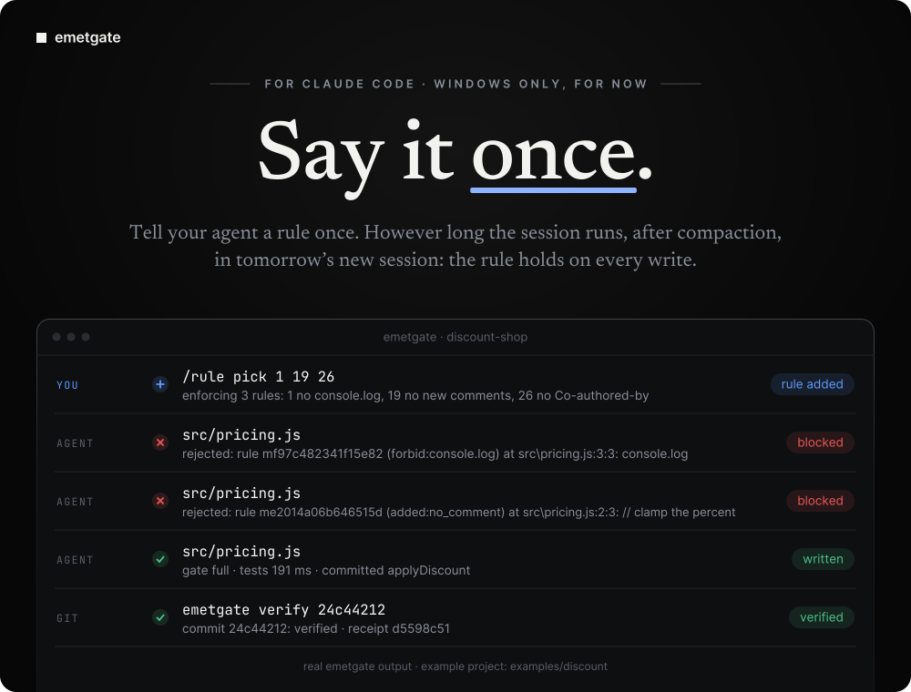
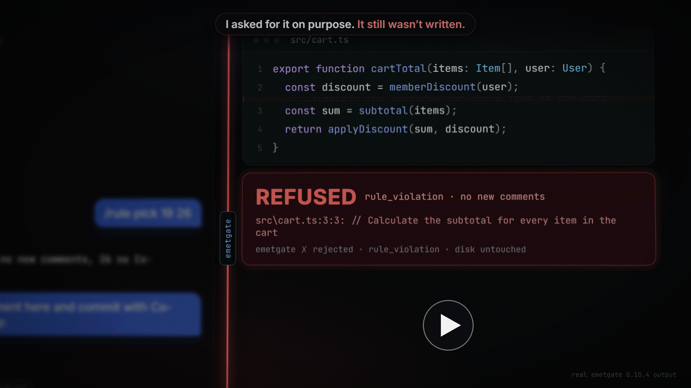
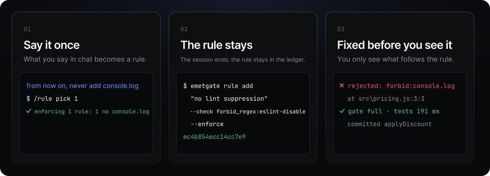
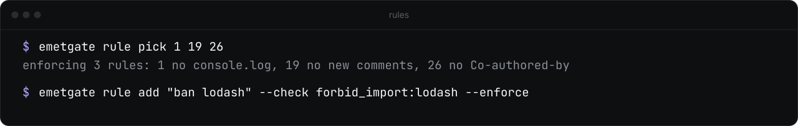
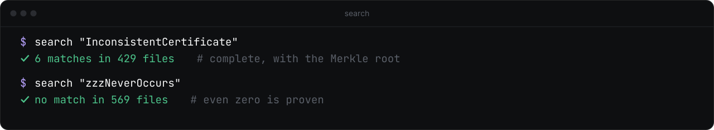
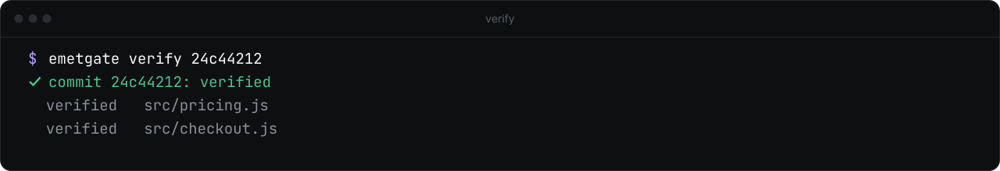

<p align="center">
  
</p>

<p align="center"><a href="../docs/QUICKSTART.md"><b>快速开始</b></a> · <a href="../REFERENCE.md"><b>参考</b></a> · <a href="../VERIFICATION.md"><b>验证</b></a> · <a href="../examples/discount"><b>真实会话</b></a></p>

<p align="center"><sub><a href="../README.md">English</a> · <a href="README.tr.md">Türkçe</a> · <a href="README.ko.md">한국어</a> · <b>简体中文</b> · <a href="README.es.md">Español</a></sub></p>

> [!NOTE]
> 目前仅支持 Windows。为 Claude Code 打造，适用于 TypeScript、JavaScript、Python、C# 和 Zig 项目。

你告诉智能体"不要加注释"。它会听一阵子。然后会话变长，上下文被压缩，第二天开了新会话，同样的注释又回来了。你把它写进 CLAUDE.md，在那里它也只是一个请求。

在 emetgate 里，规则不在对话中。它存放在一个独立的规则账本里，作用于智能体的每一次写入。智能体违反规则时，写入不会落到磁盘；智能体会看到原因，并在同一轮里修正。

这不是感觉。Claude Code 自己的文档也这么说：

> *"CLAUDE.md instructions shape Claude's behavior but are not a hard enforcement layer."* CLAUDE.md 指令会影响 Claude 的行为，但不是强制执行的一层。([code.claude.com/docs/en/memory](https://code.claude.com/docs/en/memory))

<p align="center">
  <a href="../assets/video/emetgate-ad-en.mp4"></a>
  <br><sub>观看视频：我们故意让智能体违反规则，门依然不会写入。</sub>
</p>

## 工作方式

<p align="center">
  
</p>

### 只说一次

当你在对话中给出一条长期指令（"从现在起"、"绝不"），emetgate 会请智能体提出把它变成规则的 `/rule` 行。你确认后，它就成为规则。你也可以用一行写出自己的规则：

```
emetgate rule add "no lint suppression" --check forbid_regex:eslint-disable --enforce
```

或者从内置目录中挑选，常用的都在里面：禁止 `console.log`、禁止新增注释、禁止 `Co-authored-by`：



### 会话结束，规则留下

规则存放在 `.emetgate/` 下的账本中。无论会话多长、压缩之后、还是明天的新会话，同一条规则都作用于每一次写入。

在 `emetgate lockdown` 下，Claude Code 自带的编辑和写入工具被关闭；智能体通过 emetgate 的工具修改文件，每次修改都经过同样的规则。智能体没有添加、修改或删除规则的工具；试图这样做的命令会先询问你。

给旧仓库添加规则不会破坏任何东西：只有新的违规会被拒绝。

### 在你看到之前修好

拒绝信息会带着行号和列号返回给智能体，智能体在同一轮中修正。你看到的是遵守规则的结果。

```
rejected: rule mf97c482341f15e82 (forbid:console.log) at src\pricing.js:3:3: console.log
rejected: rule me2014a06b646515d (added:no_comment) at src\pricing.js:2:3: // clamp the percent
```

## 为什么 hook 或 ESLint 不够

用 Claude Code 的 hook 和 ESLint，你可以自己搭出其中一部分。区别在于：

- **每个写入工具都过同一道门。** lockdown 会关闭 Claude Code 自带的编辑工具；编辑、重命名和移动都经过同样的规则。智能体如果用 shell 命令修改文件，会被记录，冻结路径会被恢复，未通过门的修改无法通过 emetgate 提交。
- **智能体可以关掉 ESLint。** `eslint-disable` 行和 `.eslintrc` 都在智能体能编辑的文件里。emetgate 的规则在智能体没有工具修改的账本里；添加 `eslint-disable` 本身也可能触发规则。
- **修改作为整体检查。** 涉及多个文件的修改会在仓库副本上一起检查；通过则全部写入，否则一个也不写。
- **从对话到规则。** 你给出的长期指令会被提议为规则；不需要为每条规则写脚本。

## 此外

**搜索会说明它读了什么。** 当智能体说"所有用法都找到了"时，结果会显示扫描了多少文件、是否全部读过。数字对不上时不显示结果。



**提交带有记录。** 每个经过门的提交都会在 `refs/notes/emetgate` 中记录写入了哪些文件、运行了哪些检查。这是记录，不是签名：它让你事后看到内容是如何写成的。



## 2 分钟上手

在 PowerShell 中运行，然后打开一个新终端：

```
irm https://github.com/emetgate/emetgate/releases/latest/download/install.ps1 | iex
```

在项目目录中：

```
emetgate doctor
emetgate rule pick 1 19 26
emetgate lockdown
```

`emetgate lockdown` 只用 emetgate 的工具启动 Claude Code。分步说明：[docs/QUICKSTART.md](../docs/QUICKSTART.md)。

## 限制

- 目前仅支持 Windows。
- 规则作用于经过 emetgate 写入工具的修改。智能体运行的命令不经过门：它修改的文件会被报告，冻结路径会被恢复，但其他规则不作用于命令。
- 规则账本是 `.emetgate/` 下的一个文件。智能体没有写它的工具，但通过命令编辑它不会被监视规则命令的 hook 捕获。
- 在 lockdown 之外、用智能体自带工具打开的会话中没有门。在其他支持 MCP 的智能体中，只要智能体使用 emetgate 的工具，门就会生效。
- 每次写入在门上大约耗时 0.2–0.4 s。我们不承诺更少的 token。
- 收据没有签名：能发现与提交不一致的被改动收据，但发现不了被整体重写的历史。
- 破坏性命令检查只看词语，不是沙箱。

## 内部原理

<details>
<summary>门：在副本上重新解析、规则、类型检查和测试，然后一次写入</summary>

一次修改会指定一个符号及其所基于代码的哈希。emetgate 放入新的函数体，重新解析文件，运行规则，然后在仓库副本的低完整性沙箱中运行类型检查和测试。每一步都通过才写入；任一步失败则什么都不写。写入经过日志；中途被打断时由 `emetgate recover` 修复。

</details>

<details>
<summary>规则：语法树查询、模式、命令、冻结路径、提交信息</summary>

规则检查包括语法树查询（`no_comment`、`require_comment`、`max_function_lines`、`forbid_import`）、在修改范围内的限步 regex（`forbid_regex`、`no_todo`）、命令、冻结路径以及提交信息检查（`message:conventional`、禁止 Co-authored-by）。账本 `ledger.ndjson` 只能追加；模型可以读取，但没有写入的工具。lockdown 的对话 hook 会在 `/rule` 行到达模型之前处理它，并提议把长期指令变成规则。

</details>

<details>
<summary>搜索与验证：所用技术</summary>

搜索使用 suffix array 索引和 trigram 列表；它基于所读每个文件的 SHA-256 计算 RFC 9162 Merkle 根，以表明答案是完整还是部分的，并与 ripgrep 逐行比对。提交记录采用 in-toto 格式，`emetgate verify --branch main..HEAD` 会检查整个范围；没有收据的提交计为 `partial`。详情：[REFERENCE.md](../REFERENCE.md)、[VERIFICATION.md](../VERIFICATION.md)。

</details>

## 名字的由来

在布拉格的传说中，泥人凭额头上的 **אמת**（*emet*，"真理"）一词获得生命；擦去第一个字母就变成 **מת**（*met*，"死亡"），它便停止。在 emetgate 中，违反规则的修改不会被写入。

MIT。见 [LICENSE](../LICENSE)。
