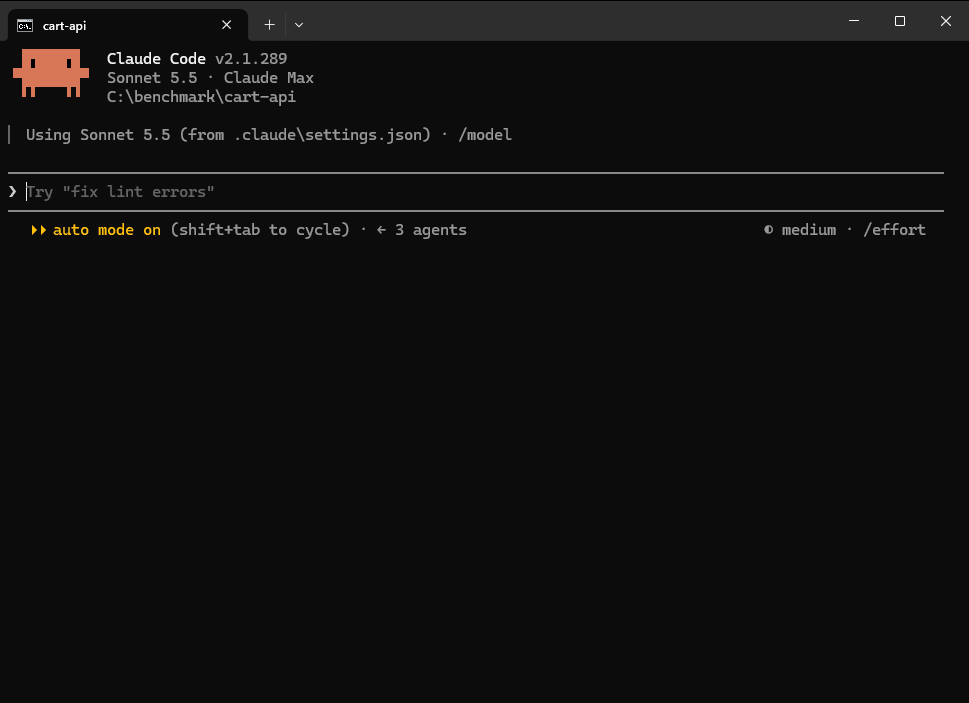
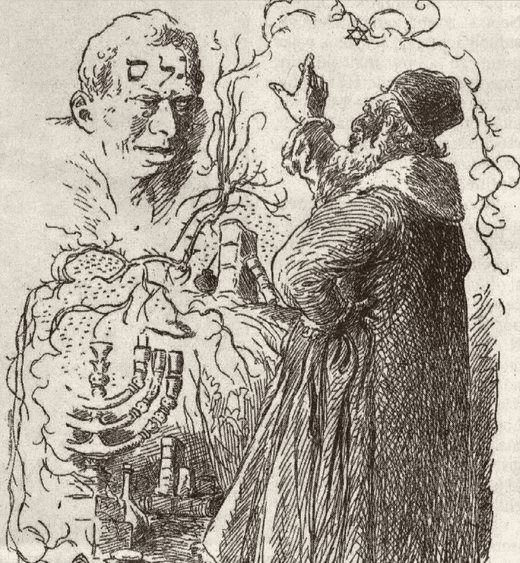

<p align="center">
  
</p>

<p align="center">
  
  
  
  <a href="https://github.com/emetgate/emetgate/actions/workflows/ci.yml"></a>
  <a href="https://github.com/emetgate/emetgate/releases/latest"></a>
</p>

<p align="center"><a href="../README.md">English</a> · <a href="README.tr.md">Türkçe</a> · <a href="README.ko.md">한국어</a> · <b>简体中文</b> · <a href="README.es.md">Español</a></p>

# Emetgate

你在 `CLAUDE.md` 里写上"不要注释"和"不要 Co-Authored-By"。模型遵守一阵子，然后就不再遵守。把文件写得更长，也只是再请求一次。

Emetgate 位于 Claude Code 和你的源码之间。模型提出修改，你的规则和测试在仓库的副本上评判它，只有通过，文件才会改变。你设置的规则会在每次写入工具调用和每次 `emetgate_commit` 时检查，无论会话持续多久，即使你亲自要求模型违反它。每个通过的修改都会留下一张之后可以核对的收据。

```
"status":"rejected","reason":"rule_violation"
"rule_text":"no new comments","file":"src\\cart.js","line":18
"text":"// apply the coupon before tax"
emetgate ✗ rejected · rule_violation · disk untouched · session 0 edits
```

Emetgate 是证人，不是保证。它报告运行了什么、发生了什么；它不能告诉你代码正确或安全。参见[限制](#限制)。

仅支持 Windows。需要 [Claude Code](https://claude.ai/code) 和 Git。

<p align="center"></p>

## 开始

下载二进制文件并加入 `PATH`（PowerShell）：

```
New-Item -ItemType Directory -Force "$env:USERPROFILE\emetgate" | Out-Null
Invoke-WebRequest "https://github.com/emetgate/emetgate/releases/latest/download/emetgate.exe" -OutFile "$env:USERPROFILE\emetgate\emetgate.exe"
[Environment]::SetEnvironmentVariable("Path", [Environment]::GetEnvironmentVariable("Path", "User") + ";$env:USERPROFILE\emetgate", "User")
```

然后打开新终端，进入项目文件夹并运行：

```
emetgate lockdown
```

安装就这些。要让自己的规则生效，在会话中输入下面这行。这里 19 是不要新注释，26 是不要 Co-authored-by，`/rule pick` 会列出全部 30 条：

```
/rule pick 19 26
```

其余各行是可选的：

| 目的 | 运行 | 作用 |
| --- | --- | --- |
| 启动会话 | `emetgate lockdown` | 用 emetgate 工具代替内置工具打开 Claude Code；每次写入都会检测测试命令 |
| 检查安装 | `emetgate doctor` | 每项检查一行；每个 `FAIL` 都以修复它的命令结尾 |
| 指定测试命令 | `claude mcp add --scope project emetgate -- emetgate mcp --test "npm test"` | 用于检测不到或检测到错误命令时；写入 `.mcp.json` |
| 添加类型检查 | 同一行加上 `--typecheck "npx tsc --noEmit"` | `tsc` 不会被检测到，必须指定 |
| 校验下载 | `Get-FileHash "$env:USERPROFILE\emetgate\emetgate.exe" -Algorithm SHA256` | 与发布页上的 `emetgate.exe.sha256` 比较 |
| 从源码构建 | `zig build -Doptimize=ReleaseSafe` | 需要 Zig 0.16.0 |

每个发布都附带 SHA-256 文件和构建来源证明。二进制文件尚未代码签名。分步说明：[docs/QUICKSTART.md](../docs/QUICKSTART.md)。

## 会话中有什么变化

| 模型想要 | 会发生什么 |
| --- | --- |
| 读取或搜索 | 无需询问即可运行，所用工具发送的文本少于整个文件 |
| 运行命令 | 任何命令都可运行，过长的输出会被裁剪后返回 |
| 运行破坏性命令 | 先询问你：`rm -rf`、`git reset --hard`、`git push --force`、`DROP TABLE`、格式化磁盘、把下载的脚本通过管道交给 shell，以及类似操作 |
| 修改文件 | 照常询问，然后修改经过闸门 |

空文件夹会执行 `git init`。驱动器根目录、主文件夹、系统文件夹或非常大的文件夹不会；lockdown 在那里拒绝启动。已有仓库的文件夹保持原样。

## 闸门

```
proposal ─▶ reparse ─▶ rules ─▶ typecheck ─▶ tests ─▶ write + receipt  (אמת)
                  └── a step fails ─▶ nothing is written (מת)
```

代码修改会指明一个符号和它所依据代码的哈希，因此过期的编辑会被拒绝。修改应用到仓库的副本上，各步骤在那里运行。如果某一步失败，你的文件保持原样，回复中带有每个失败测试的输出，模型无需重跑测试套件就能修复。

每一步做什么、不做什么：

| 步骤 | 何时运行 | 说明 |
| --- | --- | --- |
| reparse | 始终，针对有解析器的语言 | 表明文件仍可解析 |
| 规则 | 当你有规则时 | 参见[规则](#规则) |
| 类型检查 | 项目配置了 mypy 或 pyright、根目录有一个 `dotnet` 项目，或使用 `--typecheck` 时 | `tsc` 不会被检测到；用 `--typecheck` 传入 |
| 测试 | 找到测试命令且代码有改动时 | 没有测试命令：写入并标记 `unverified_no_tests`；只改了非代码文件：不运行测试 |
| 收据 | 每次通过的写入 | 参见[收据](#收据) |

闸门的测试规则是：**之前没有失败的测试不得失败。** 已经失败的测试不会阻止写入，回复会指明它（`baseline_failing`、`failing_tests`）。pytest 和 `dotnet test` 还允许新的失败测试保留到 `emetgate_commit`，欠账记录在 `tests/debt.json`，因此你可以先写测试，下一步再让它通过。分析证明不会影响到自身符号之外的修改，如果配置了范围测试命令，就运行它而不是整个套件。

## 语言

| | read, try, scan, 规则 | rename | move, move_file | 调用图（`facts`） | `explore`, `map` |
| --- | :-: | :-: | :-: | :-: | :-: |
| TypeScript, TSX, JavaScript | 是 | 是 | 是 | 是 | 是 |
| Python | 是 | 是 | 是 | 是 | `map` 是，`explore` 部分 |
| C# | 是 | 是 | 类型和静态成员 | 部分 | `map` 是，`explore` 部分 |
| Zig | 是（顶层函数） | 否 | 否 | 否 | 否 |
| JSON, Markdown | 按节读写 | - | - | - | - |

`map` 能识别 Python 和 C# 的测试、路由和命令。`explore` 仍会把一些不是测试的名字当作测试，例如 `latest_news.py`。Rename 无法跟踪通过无类型局部变量调用的方法。C# 实例成员不会移动，因为它依赖其对象。从带装饰器或顶层语句的文件中移出 Python 符号需要 `order_change:true`。Python 和 C# 没有语言服务。两者的对等支持正在进行中。

测试命令从以下内容检测：`package.json`、`build.zig`、`Cargo.toml`、`go.mod`、Python 项目标记、`.sln`、`.slnx`、`.csproj`、`.fsproj`、`.vbproj` 和嵌套的测试项目。

## 工具

模型获得 23 个工具。完整参数：[REFERENCE.md](../REFERENCE.md)。

| | 工具 |
| --- | --- |
| 理解 | `explore`（从问题到定义、调用者和影响）、`evidence`、`symbols`、`skeleton` |
| 读取 | `read_symbol`、`read_file`（一次调用最多 32 个文件，JSON pointer，Markdown 标题，行范围）、`list` |
| 搜索 | `search`（字面量或正则，按跟踪文件）、`find`（任意文件中忽略大小写的字面量） |
| 修改代码 | `try`、`try_batch`（多文件，全部或全不）、`edit`、`write`、`rename`、`move`、`move_file` |
| 修改文档 | `write_doc`（JSON、Markdown、范围） |
| 检查 | `scan`（在仓库上运行一项检查）、`mutate`（预览） |
| git 和 shell | `git`（只读）、`git_write`（标志白名单；造成丢失需要 `force: true`）、`commit`（带收据）、`run` |

给你用的命令行工具：`doctor`、`verify`、`rule`、`rules`（终端界面）、`recover`、`commit`、`receipts attach`、`facts`、`map`、`find`、`scan`、`stats`。

## 规则

用 `--enforce` 设置的规则在每次写入时都生效；没有它，规则只被记录和显示。模型可以读取规则但不能修改，会修改规则的命令会先询问你。规则保存在只追加的 `.emetgate/ledger.ndjson` 中。

**设置规则。** `/rule` 行在提示发送前处理，因此不会到达模型。

| 位置 | 命令 | 作用 |
| --- | --- | --- |
| 会话中 | `/rule pick` | 显示下面 30 条现成规则 |
| 会话中 | `/rule pick 1 19 26 in src/` | 采用这些规则，此处仅限 `src/` 下 |
| 会话中 | `/rule add "ban lodash" --check forbid_import:lodash --enforce` | 添加你自己的规则 |
| 会话中 | `/rule list`、`/rule supersede <id> "new text"`、`/rule forget <id>` | 显示、替换或停用规则 |
| 终端中 | `emetgate rule add ...` | 相同命令，不带斜杠 |
| 终端中 | `emetgate rules` | 同样规则的终端界面 |

`--in` 把规则限制到一个文件、以 `/` 结尾的文件夹或 `file#symbol`。

**规则可以检查什么。**

| 检查 | 写入被拒绝的情况 |
| --- | --- |
| `no_comment` | 含有注释 |
| `require_comment` | 函数、方法或类前没有注释 |
| `no_todo` | 含有 `TODO`、`FIXME` 或 `XXX` |
| `forbid:<text>` | 含有此文本 |
| `require:<text>` | 不含此文本 |
| `forbid_regex:<pattern>` | 匹配此正则 |
| `no_literal:<option>` | 硬编码此选项，例如对 `timeout: 30000` 使用 `no_literal:timeout` |
| `forbid_import:<module>` | 导入此模块 |
| `max_function_lines:<n>` | 函数超过 n 行 |
| `q:<query>` | 此 tree-sitter 查询匹配 |
| `added:<check>` | 检查只在修改新增的内容上失败，因此旧代码不会阻止写入 |
| `cmd:<command>` | 你自己的命令在沙箱内的副本上运行并报告违规 |
| `frozen` | 修改了规则 `--in` 范围内的路径 |
| `message:<check>` | 提交信息违反它：`forbid`、`require`、`max_lines`、`max_subject`、`max_line`、`conventional` |

**`/rule pick` 中的现成规则。**

| 分组 | 规则 |
| --- | --- |
| 代码风格，JS 和 TS | 禁止 `console.log`、`debugger`、`alert`、`var`、`any`、`document.write`、`innerHTML`、`dangerouslySetInnerHTML`、聚焦测试（`.only`）、`@ts-ignore` |
| 代码风格，Python | 禁止 `print`、`exec`、`assert`、裸 `except`、`pickle` |
| 代码风格，C# | 禁止 `Console.WriteLine`、`Debug.WriteLine`、`Thread.Sleep` |
| 代码风格，任意语言 | 禁止新注释，定义需要 doc comment，函数最多 50 行，禁止 `TODO`/`FIXME`/`XXX` |
| 安全 | 禁止 `eval`、硬编码密钥（按正则）、`http://` URL |
| git 规范 | 禁止 `Co-authored-by`，禁止 "Generated with Claude"，禁止 `WIP`，conventional commit 标题 |
| 架构 | 冻结路径 |

`frozen` 路径不能通过写入工具改变，`emetgate_run` 会在每条命令后恢复它。通过 `emetgate_run` 的 `git commit` 会先询问你。

## 收据

通过的写入会绑定一条 [in-toto](https://in-toto.io) 记录，说明由什么、用哪些测试构建了什么。`emetgate_commit` 把它作为 git note 存到 `refs/notes/emetgate` 下。

```
$ emetgate verify --branch main..HEAD
branch partial: 48 commit(s)          # no receipt: not called verified
  a179a7f unverified (no receipt)  cert 84c2…

# after tampering with one receipt:
branch broken: 1 commit(s)
  3ff23a0 MISMATCH  cert ec79…
```

提交的状态是 `verified`、`merged`、`unverified` 或 `mismatch`；范围的状态是 `verified`、`partial`、`broken` 或 `empty`，空范围视为失败。`tools/verify_py/emetgate_verify.py` 用 Python 独立检查收据。

收据没有签名，链尾也不公开。这能发现与提交不一致的收据编辑。它不能发现连同新生成的一致收据一起重写的提交。

## 搜索

有两个搜索工具，都不会返回整个文件。

| | `search` | `find` |
| --- | --- | --- |
| 查找范围 | `dir` 下 git 跟踪的文本文件 | git 列出的所有文件，跟踪或未跟踪，未被忽略 |
| 匹配 | 区分大小写的字面量，或带 `regex:true` 的正则 | 任意大小写的字面量，任意字节，任意语言 |
| 索引 | 三元组 | suffix array 和 wavelet matrix，位于一个内存映射文件中 |
| 回复 | 每个文件一次，然后每个命中 `line:text`，定义上标 `*` | 命中数和文件数，命中最多的 20 个文件，前 40 个命中 |
| 命中很多时 | `partial`，带继续用的下一个 offset | 回复大小不变 |
| 缩小范围 | `kinds:["code"]` 跳过注释和字符串 | - |
| 适用于 | 代码 | 日志、配置、生成的和未跟踪的文件 |

`search` 还会回复其读取文件的 Merkle 根（RFC 9162），因此完整回答和部分回答在回复中即可区分。索引无法处理的正则交给 ripgrep，回复会写 `delegated: rg`。如果证书的数字对不上，回复会以 `InconsistentCertificate` 被拒绝。

```
$ search "InconsistentCertificate"
✓ 6 matches in 429 files
$ search "Allocator"
partial: matches 1-46 of 1617; next offset:46
$ search "zzzNeverOccurs"
✓ no match in 569 files
```

在 n8n 上：新会话首次搜索 5.5 到 22.7 ms，之后的搜索 1.9 到 10.1 ms，对比 rg 27.2 到 80.9 ms 和 git grep 29.1 到 65.7 ms；首次建立索引（每个仓库一次）耗时 91 到 1,335 ms（2026-09-27，扫描带宽 3.13 GB/s）。

## 如何测试

变异测试故意破坏代码，检查测试套件是否发现。模糊测试和红队语料提供意外和恶意的输入。CI 在每个 pull request 上以 Debug 和 ReleaseSafe 运行完整套件，夜间运行覆盖全部变异语料。

引擎部分：目前 69 个变异体：58 个被杀死，6 个被证明等价，4 个冗余防护作为纵深防御保留，1 个未解决。列表见 [VERIFICATION.md](../VERIFICATION.md)。

## 限制

- 仅支持 Windows。
- **通过闸门证明修改可解析并通过你的测试。** 它只和这些测试一样强，没有测试时几乎证明不了什么（`unverified_no_tests`）。
- **规则只在你设置之后生效，并且只评判写入工具和 `emetgate_commit`。** 通过 `emetgate_run` 运行的命令不受评判：模型运行的脚本可以添加注释，被恢复的只有 `frozen` 路径。那里的 `git commit` 会先询问你，提交信息规则不会读取它。
- **没有任何东西检查测试是否被削弱。** 测试文件夹没有 `frozen` 规则时，修改测试并通过的编辑会被写入。
- **lockdown 中的 `emetgate_run` 没有沙箱。** 命令以你的权限运行。
- **破坏性命令询问读取的是命令的文字。** 它看不到模型写好后运行的脚本内部，所以它是减速带，不是墙。请阅读你批准的内容。
- **`frozen` 有漏洞。** 模型运行的脚本所做的提交不会询问；它会记录在 `frozen_committed` 中，`emetgate verify` 不会称之为 verified。被忽略的文件、未跟踪的构建和缓存文件夹、符号链接、子模块文件夹以及比命令活得更久的进程都不受保护。`commit` 以外的 `emetgate_git_write` 命令，如 `reset`、`restore` 或 `stash`，仍可能移动冻结路径。
- 闸门自身测试运行周围的沙箱只阻止写入，不阻止读取或网络。
- Python 和 C# 的不足列在[语言](#语言)中。
- 基准测试是我们自己做的，来自一台机器，可从 [tests/bench](../tests/bench) 复现。

## 深入了解

- [docs/QUICKSTART.md](../docs/QUICKSTART.md)：分步安装
- [REFERENCE.md](../REFERENCE.md)：每个工具和标志，包括 `.mcp.json` 设置、`--commit`、`--typecheck`、`--allow-run` 和 `.emetgaterc.json`
- [VERIFICATION.md](../VERIFICATION.md)：收据和证明

## 名字的由来

<picture>
  <source media="(prefers-color-scheme: dark)" srcset="../assets/golem-ales-dark.jpg">
  
</picture>

在布拉格的传说中，傀儡因额头上的 **אמת**（*emet*，"真理"）一词而获得生命。擦去第一个字母，**אמת** 就变成 **מת**（*met*，"死"），傀儡随之静止。修改站得住脚时，闸门写下第一个字母；失败的测试则擦去它。

<br clear="left">

## 许可证

MIT。参见 [LICENSE](../LICENSE)。
